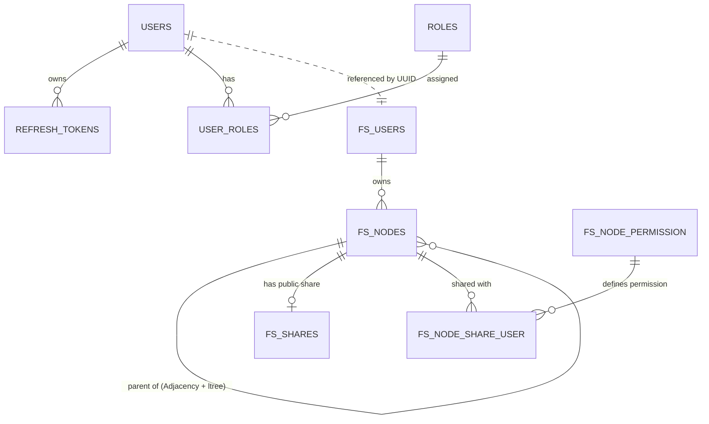

# BÁO CÁO TIẾN ĐỘ ĐỒ ÁN 3
## Hệ thống lưu trữ đám mây thông minh tích hợp AI Agent quản trị (Smart Cloud Storage with Agentic AI)

---

## 1. Tổng quan & Mục đích dự án
- **Mục đích:** Xây dựng một hệ thống lưu trữ đám mây thông minh (Smart Cloud Storage) không chỉ dừng lại ở việc lưu trữ tĩnh các tệp tin mà còn có khả năng "hiểu" và phân tích nội dung dữ liệu. Hệ thống cung cấp đầy đủ các chức năng cốt lõi của một dịch vụ lưu trữ đám mây hiện đại, đồng thời tích hợp một hệ thống AI Agent tự chủ để quản lý phân cấp thư mục, tự động phân loại tài liệu, tìm kiếm ngữ nghĩa và truy vấn/tổng hợp thông tin từ tài liệu người dùng.
- **Mô hình kiến trúc tổng thể:** Microservices Architecture phân tán với các thành phần chính:
  1. **API Gateway:** Cổng tiếp nhận tập trung (Spring Cloud Gateway), xử lý routing, rate limiting, giải mã và thẩm định JWT Token.
  2. **User Service:** Quản lý tài khoản, định danh người dùng, xác thực và phân quyền (RBAC) trên nền tảng Spring Boot.
  3. **Storage Service (Cloud Storage Core):** Lõi dịch vụ lưu trữ, quản lý cấu trúc cây thư mục phân cấp (File & Folder Hierarchy), tích hợp Object Storage chuẩn S3 (MinIO) và quản lý hạn mức (Quota).
  4. **AI Agent Service:** Điều phối luồng xử lý thông minh, trích xuất dữ liệu, RAG (Retrieval-Augmented Generation) và Function Calling để thao tác với cây thư mục.
  5. **Hạ tầng truyền thông & Lưu trữ:** Apache Kafka (Event Bus bất đồng bộ), gRPC (Giao tiếp nội bộ tốc độ cao), MinIO S3 Object Storage, và cơ sở dữ liệu PostgreSQL cho từng service.

---

## 2. Tiến độ thực hiện & Phân tích Git Commits (Tính đến hết Thứ Hai tuần trước)

Dựa trên lịch sử git commit của dự án, tiến độ trong tuần qua (mốc đánh giá tính đến hết Thứ Hai tuần trước - 19/10/2026, cùng các cập nhật liên quan) tập trung hoàn thành nền tảng hạ tầng, chuẩn hóa User Service, thiết kế & hiện thực hóa CSDL Cây thư mục cho Storage Service, và thiết lập API Contract giữa các dịch vụ:

### 2.1. Phân tích chi tiết các đầu việc qua Git Commits
| Thời gian (Commit) | Mã Hash | Nội dung công việc (Commit Message) | Kết quả kỹ thuật đạt được |
| :--- | :--- | :--- | :--- |
| **13/10/2026 15:58** | `2e5411d` | `feat: add template for cloud storage module` | Khởi tạo cấu trúc dự án mẫu cho module `storage-service`, cấu hình Gradle và môi trường ban đầu. |
| **13/10/2026 17:05** | `2fd415e` | `docs: add overall usecase diagram` | Thiết kế sơ đồ Usecase tổng thể hệ thống, phân rã các nhóm chức năng: Lưu trữ, Chia sẻ, Quản trị và AI Agent. |
| **13/10/2026 17:28** | `d0a0cd8` | `docs: add system architecture diagram` | Thiết kế kiến trúc tổng thể Microservices, xác định ranh giới (bounded context) giữa Client, API Gateway, User Service, Storage Service và AI Agent. |
| **14/10/2026 12:15** | `ef549fe` | `feat: update docs and add example UI` | Cập nhật tài liệu kỹ thuật và xây dựng prototype giao diện người dùng (quản lý file/folder). |
| **14/10/2026 12:30** | `e1c5643` | `chore: change service name from auth-service to user-service` | Tái cấu trúc (refactor) tên định danh từ `auth-service` thành `user-service` nhằm mở rộng phạm vi quản lý hồ sơ và quota người dùng. |
| **14/10/2026 15:15** | `dc20805` | `feat: update database schema and change logic of services` | Cập nhật schema cơ sở dữ liệu cho User Service: thiết kế bảng USERS, ROLES, USER_ROLES, hoàn thiện quan hệ RBAC. |
| **15/10/2026 22:40** | `1433c27` | `feat: add common library` | Xây dựng module dùng chung `common`: chuẩn hóa cấu trúc phản hồi `ApiResponse<T>`, tập trung xử lý lỗi ngoại lệ `GlobalExceptionHandler` và các DTO dùng chung. |
| **16/10/2026 17:46** | `095ec40` | `feat: change logic of refresh-token and database` | Hiện thực bảng `REFRESH_TOKENS`, cải tiến cơ chế xác thực: thu hồi (revoke) token cũ khi login mới, lưu vết IP và thiết bị client. |
| **17/10/2026 19:57** | `34e9825` | `feat: add api-gateway template to work later and connect services to api gateway` | Thiết lập module `api-gateway` dựa trên Spring Cloud Gateway, cấu hình Security & AuthFilter xử lý thẩm định JWT tập trung. |
| **18/10/2026 22:17** | `b941e4b` | `feat: update user-service to prod` | Tối ưu hóa cấu hình production cho `user-service`, cấu hình biến môi trường kết nối cơ sở dữ liệu và bảo mật. |
| **18/10/2026 22:17** | `f394e8c` | `feat: update storage service database` | **Trọng tâm tuần:** Thiết kế và triển khai CSDL Storage Service (`V1__storage_service_init_schema.sql`), ứng dụng PostgreSQL `ltree` cho cây thư mục, bảng `fs_nodes`, `fs_users`, `fs_shares`, `fs_node_permission`, `fs_node_share_user`. |
| **19/10/2026 16:58** | `c787053` | `chore: validate shared dependencies` | **Mốc chốt Thứ Hai:** Rà soát, kiểm định tính tương thích giữa các thư viện dùng chung (Spring Boot, Jackson, JWT, Postgres driver). |
| *23/10 - 26/10* | `04310e1` - `90d3ff5` | *Cập nhật mở rộng hạ tầng & tích hợp liên dịch vụ* | Tích hợp gRPC giữa User Service và Storage Service, tích hợp Apache Kafka cho sự kiện tạo user, đồng bộ hóa phiên bản thư viện qua Version Catalog TOML và docker-compose. |

---

## 3. Thiết kế cơ sở dữ liệu (Database Design)

Để đáp ứng mô hình kiến trúc Microservices độc lập về cơ sở dữ liệu (Database-per-Service Pattern), hệ thống phân tách CSDL thành các schema chuyên biệt:



### 3.1. Cơ sở dữ liệu User Service (Xác thực & Phân quyền RBAC)
Cơ sở dữ liệu của User Service chịu trách nhiệm quản lý danh tính, phân quyền vai trò (Role-Based Access Control) và phiên làm việc:

1. **Bảng `USERS`:** Quản lý thông tin định danh và trạng thái tài khoản.
   - `id` (UUID, PK): Định danh duy nhất của người dùng.
   - `username` (VARCHAR, UK): Tên đăng nhập duy nhất.
   - `email` (VARCHAR, UK): Địa chỉ email duy nhất.
   - `password` (VARCHAR): Mật khẩu đã được mã hóa an toàn (BCrypt).
   - `display_name` (VARCHAR): Tên hiển thị người dùng.
   - `avatar_url` (VARCHAR): Đường dẫn ảnh đại diện.
   - `enabled` (BOOLEAN): Trạng thái hoạt động tài khoản.
   - `created_at`, `updated_at` (TIMESTAMP): Thời gian khởi tạo và cập nhật.

2. **Bảng `ROLES`:** Quản lý các vai trò trong hệ thống.
   - `id` (BIGINT, PK): Định danh vai trò tự tăng.
   - `code` (VARCHAR): Mã kỹ thuật vai trò (VD: `ROLE_USER`, `ROLE_ADMIN`).
   - `name` (VARCHAR, UK): Tên hiển thị vai trò.

3. **Bảng `USER_ROLES`:** Bảng quan hệ Nhiều - Nhiều (N-N) giữa người dùng và vai trò.
   - `user_id` (UUID, PK, FK -> `USERS.id` CASCADE DELETE)
   - `role_id` (BIGINT, PK, FK -> `ROLES.id`)

4. **Bảng `REFRESH_TOKENS`:** Quản lý phiên đăng nhập và vòng đời token.
   - `id` (BIGINT, PK): Định danh bản ghi tự tăng.
   - `token` (VARCHAR(512), UK): Chuỗi Refresh Token.
   - `user_id` (UUID, FK -> `USERS.id`): Người dùng sở hữu token.
   - `device_info` (VARCHAR): Thông tin thiết bị/trình duyệt đăng nhập.
   - `ip_address` (VARCHAR): Địa chỉ IP của client đăng nhập.
   - `revokes_at` (TIMESTAMP): Thời điểm thu hồi/hết hạn của phiên.
   - `created_at` (TIMESTAMP): Thời điểm khởi tạo.

---

### 3.2. Cơ sở dữ liệu Storage Service (Quản lý Cây thư mục & Dung lượng lưu trữ)

Cơ sở dữ liệu của Storage Service được thiết kế chuyên biệt để giải quyết bài toán cốt lõi: **Quản lý cấu trúc cây thư mục vô hạn cấp (Hierarchical Tree Structure)** với hiệu năng cao, hỗ trợ phân quyền chi tiết, chia sẻ tệp tin và kiểm soát hạn mức lưu trữ (Quota).

#### Giải pháp kỹ thuật quản lý cây thư mục: Kết hợp Adjacency List và PostgreSQL `ltree`
- **Mô hình Danh sách kề (`parent_id`):** Dùng để truy vấn các nút con trực tiếp (`immediate children`) trong thao tác duyệt thư mục hàng ngày với chi phí truy vấn $O(1)$ thông qua chỉ mục b-tree.
- **Mô hình Đường dẫn hiện thực hóa (Materialized Path qua Extension `ltree`):** Trường `path` lưu trữ chuỗi nhãn phân cấp phân tách bởi dấu chấm (ví dụ: `root.1.4.5`). Cơ chế này mang lại các ưu thế vượt trội:
  - **Truy vấn cây con (Subtree):** Lấy toàn bộ cây con bên dưới một thư mục với một câu lệnh đơn giản (`path <@ 'root.1.4'`), không cần dùng đệ quy CTE (`WITH RECURSIVE`) gây nghẽn tài nguyên CSDL.
  - **Truy vết tổ tiên (Ancestors):** Lấy toàn bộ đường dẫn breadcrumb từ root tới node hiện tại tức thì (`path @> 'root.1.4.5'`).
  - **Tối ưu hóa hiệu năng:** Đánh chỉ mục chuyên biệt GiST (`idx_fs_nodes_path_gist`) và B-Tree (`idx_fs_nodes_path_btree`) giúp tìm kiếm theo pattern phân cấp cực nhanh ngay cả khi hệ thống có hàng triệu files.

#### Chi tiết các bảng trong Storage Service:

#### Bảng `FS_USERS` (Quản lý không gian lưu trữ & Quota người dùng)
Lưu trữ thông số kỹ thuật về vùng lưu trữ MinIO/S3 và hạn mức dung lượng của từng người dùng.
| Tên trường (Column) | Kiểu dữ liệu | Ràng buộc | Ý nghĩa & Vai trò trong Storage Service |
| :--- | :--- | :--- | :--- |
| `id` | UUID | PK | Khóa chính, tương ứng với mã định danh người dùng từ User Service. |
| `storage_prefix` | VARCHAR(255) | NOT NULL | Tiền tố đường dẫn lưu trữ của user trên MinIO (ví dụ: `bucket/user_id`). |
| `storage_bucket_name`| VARCHAR(255) | | Tên bucket Object Storage chỉ định cho người dùng. |
| `storage_max_quota_bytes` | BIGINT | | Dung lượng tối đa được phép lưu trữ (mặc định gói Free: 15 GB = 16,106,127,360 bytes). |
| `storage_current_quota_bytes` | BIGINT | | Dung lượng thực tế người dùng đã tiêu thụ (tự động cộng/trừ khi upload/xóa). |
| `created_at` | TIMESTAMP | | Thời điểm khởi tạo không gian lưu trữ của người dùng. |
| `updated_at` | TIMESTAMP | | Thời điểm cập nhật quota/thông tin gần nhất. |

#### Bảng `FS_NODES` (Cốt lõi Cây thư mục - Quản lý File & Thư mục)
Quản lý mọi nút (node) trong cây phân cấp, bao gồm cả thư mục (folder) và tập tin vật lý (file).
| Tên trường (Column) | Kiểu dữ liệu | Ràng buộc | Ý nghĩa & Vai trò trong Storage Service |
| :--- | :--- | :--- | :--- |
| `id` | BIGINT | PK (Identity)| Khóa chính định danh duy nhất cho từng file hoặc thư mục. |
| `user_id` | UUID | FK -> `fs_users(id)`, NOT NULL | Định danh người dùng sở hữu file/thư mục này. |
| `path` | LTREE | | Đường dẫn hiện thực hóa phân cấp (ví dụ: `root.10.25`). Hỗ trợ chỉ mục GiST/B-tree. |
| `parent_id` | BIGINT | FK -> `fs_nodes(id)`, NULLABLE | ID thư mục cha trực tiếp. Giá trị `NULL` biểu thị đây là Thư mục gốc (Root Node). |
| `name` | VARCHAR(255) | NOT NULL | Tên hiển thị của file hoặc thư mục (ví dụ: `bao-cao.pdf`, `Du_An_3`). |
| `is_folder` | BOOLEAN | NOT NULL | Cờ nhận diện loại node: `TRUE` là Thư mục, `FALSE` là Tập tin. |
| `node_status` | VARCHAR(20) | | Trạng thái vòng đời node: `PENDING_UPLOAD`, `ACTIVE`, `FAILED`, `ARCHIVED`. |
| `storage_bucket_name`| VARCHAR(100)| | Tên bucket S3 chứa đối tượng file vật lý. |
| `s3_object_key` | VARCHAR(500) | | Đường dẫn định danh tệp tin trên MinIO Object Storage (Folder để trống). |
| `mime_type` | VARCHAR(120) | | Kiểu tệp tin (MIME Type, ví dụ: `application/pdf`, `image/png`). Folder có giá trị null. |
| `size_bytes` | BIGINT | | Kích thước tệp tin tính theo bytes (Folder có kích thước logic là 0). |
| `etag` | VARCHAR(100) | | Mã băm ETag/MD5 của tệp tin trên MinIO dùng kiểm tra tính toàn vẹn dữ liệu. |
| `is_starred` | BOOLEAN | NOT NULL | Cờ đánh dấu tệp/thư mục yêu thích (phục vụ chức năng Quick Access). |
| `created_at` | TIMESTAMP | NOT NULL | Thời điểm khởi tạo file/thư mục. |
| `updated_at` | TIMESTAMP | | Thời điểm cập nhật metadata gần nhất. |
| `deleted_at` | TIMESTAMP | | Thời điểm xóa vào thùng rác (Soft Delete). Nếu `NULL` là node đang hoạt động. |
- **Ràng buộc toàn vẹn (Unique Constraint):** `uq_fs_nodes_parent_id_name (parent_id, name)` đảm bảo trong cùng một thư mục cha không thể tồn tại hai file/thư mục trùng tên.
- **Chỉ mục tăng tốc (Indexes):**
  - `idx_node_browse (user_id, parent_id, is_folder, name)`: Tối ưu hóa tuyệt đối cho thao tác duyệt thư mục của người dùng.
  - `idx_fs_nodes_path_gist USING GIST (path)`: Tối ưu cho các truy vấn kiểm tra tổ tiên, cây con và phân quyền thừa kế.
  - `idx_fs_nodes_path_btree USING BTREE (path)`: Tối ưu cho sắp xếp và đối sánh tiền tố đường dẫn.

#### Bảng `FS_NODE_PERMISSION` (Danh mục quyền truy cập trên Node)
Định nghĩa danh mục các quyền hạn có thể gán cho người dùng trên từng file/folder.
| Tên trường (Column) | Kiểu dữ liệu | Ràng buộc | Ý nghĩa & Vai trò trong Storage Service |
| :--- | :--- | :--- | :--- |
| `id` | BIGINT | PK (Identity)| Mã định danh quyền hạn. |
| `code` | VARCHAR(20) | UK, NOT NULL | Mã kỹ thuật của quyền (VD: `READ`, `WRITE`, `ADMIN`). |
| `description` | VARCHAR(255) | | Mô tả chi tiết phạm vi tác nghiệp của quyền. |

#### Bảng `FS_NODE_SHARE_USER` (Phân quyền truy cập theo người dùng)
Lưu trữ danh sách người dùng được chia sẻ quyền truy cập cụ thể trên từng file hoặc thư mục.
| Tên trường (Column) | Kiểu dữ liệu | Ràng buộc | Ý nghĩa & Vai trò trong Storage Service |
| :--- | :--- | :--- | :--- |
| `id` | UUID | PK | Khóa chính của bản ghi cấp quyền. |
| `node_id` | BIGINT | FK -> `fs_nodes(id)`, NOT NULL | Node (file hoặc thư mục) được chia sẻ quyền. |
| `user_id` | UUID | NOT NULL | Mã định danh người dùng được cấp quyền truy cập. |
| `permission_id` | BIGINT | FK -> `fs_node_permission(id)` | Quyền hạn tương ứng được cấp (`READ`, `WRITE`,...). |
| `granted_by` | UUID | NOT NULL | Người dùng thực hiện cấp quyền. |
| `created_at` | TIMESTAMP | NOT NULL | Thời điểm cấp quyền. |
| `updated_at` | TIMESTAMP | | Thời điểm thay đổi quyền gần nhất. |
- **Chỉ mục:** `idx_share_users_user_id (user_id)` và `idx_share_users_node_id (node_id)`.

#### Bảng `FS_SHARES` (Quản lý liên kết chia sẻ công khai)
Quản lý các liên kết chia sẻ công khai ra ngoài (Public Share Links) có thiết lập thời hạn và giới hạn số lượt tải.
| Tên trường (Column) | Kiểu dữ liệu | Ràng buộc | Ý nghĩa & Vai trò trong Storage Service |
| :--- | :--- | :--- | :--- |
| `id` | UUID | PK | Khóa chính của liên kết chia sẻ. |
| `node_id` | BIGINT | FK -> `fs_nodes(id)`, UK, NOT NULL | Tệp tin hoặc thư mục được tạo link chia sẻ. |
| `created_by` | UUID | NOT NULL | Người dùng tạo liên kết chia sẻ. |
| `is_public` | BOOLEAN | NOT NULL | Trạng thái công khai của liên kết (`TRUE`: mở cho mọi người có link). |
| `shared_url` | VARCHAR(500) | | Mã token hoặc đường dẫn công khai sinh ngẫu nhiên bảo mật. |
| `expires_at` | TIMESTAMP | | Thời điểm hết hạn của liên kết chia sẻ (nếu có). |
| `max_access_count` | INTEGER | | Giới hạn số lượt truy cập tối đa cho phép. |
| `access_count` | INTEGER | | Số lượt thực tế đã truy cập/tải xuống qua link này. |
| `status` | VARCHAR(20) | | Trạng thái hiệu lực của liên kết (`ACTIVE`, `EXPIRED`, `REVOKED`). |
| `created_at` | TIMESTAMP | NOT NULL | Thời điểm tạo liên kết. |
| `updated_at` | TIMESTAMP | | Thời điểm cập nhật trạng thái liên kết. |

---

## 4. Đặc tả Hợp đồng Giao tiếp (API Contract Specification)

### 4.1. Quy ước giao tiếp chung & Cơ chế định tuyến qua API Gateway
- **Cổng tiếp nhận Gateway:** `http://localhost:8089`
- **Routing Rules:**
  - `/api/v1/user-service/**` $\rightarrow$ chuyển tiếp tới `http://user-service:8081`
  - `/api/v1/storage-service/**` $\rightarrow$ chuyển tiếp tới `http://storage-service:8082`
- **Cơ chế thẩm định JWT & Tiêm Context:** Client gửi header `Authorization: Bearer <access_token>`. API Gateway thực hiện giải mã token, xác thực chữ ký và tính hợp lệ, sau đó bóc tách thông tin và tiêm vào HTTP Headers trước khi forward đến các service nội bộ:
  - `X-User-Id`: UUID định danh người dùng.
  - `X-User-Roles`: Danh sách vai trò của người dùng (ví dụ: `ROLE_USER,ROLE_ADMIN`).
- **Cấu trúc Envelope dữ liệu chuẩn (`ApiResponse<T>`):**
```json
{
  "success": true,
  "message": "Thông điệp xử lý",
  "code": 200,
  "data": { ... },
  "timestamp": "2026-10-26T00:00:00Z"
}
```

---

### 4.2. API Contract - User Service
| Phương thức | Đường dẫn API | Header xác thực | Mục đích & Nghiệp vụ |
| :--- | :--- | :--- | :--- |
| `POST` | `/api/v1/user-service/auth/register` | Không yêu cầu | Đăng ký tài khoản người dùng mới, gán `ROLE_USER`, phát sinh sự kiện khởi tạo hệ thống. |
| `POST` | `/api/v1/user-service/auth/login` | Không yêu cầu | Đăng nhập bằng username/password, thu hồi refresh token cũ và cấp mới cặp Access/Refresh Token. |
| `POST` | `/api/v1/user-service/auth/refresh` | Không yêu cầu | Sử dụng Refresh Token hợp lệ để cấp mới Access Token. |
| `POST` | `/api/v1/user-service/auth/logout` | Không yêu cầu | Thu hồi Refresh Token, đóng phiên đăng nhập trên thiết bị. |
| `GET` | `/api/v1/user-service/users/me` | Bearer Token | Lấy thông tin hồ sơ của người dùng đang đăng nhập. |
| `GET` | `/api/v1/user-service/users/{id}` | Bearer Token | Lấy thông tin chi tiết user theo ID (Chỉ Admin hoặc chính chủ tài khoản). |
| `GET` | `/api/v1/user-service/users` | Bearer Token | Danh sách phân trang người dùng (Dành riêng cho Quản trị viên `ROLE_ADMIN`). |
| `DELETE`| `/api/v1/user-service/users/{id}` | Bearer Token | Vô hiệu hóa/Xóa người dùng (Dành riêng cho Quản trị viên `ROLE_ADMIN`). |

#### Chi tiết Payload tiêu biểu (User Service):
- **Đăng ký (`POST /auth/register`):**
  - *Request Body:* `{"username": "taikhuong", "email": "tai@hust.edu.vn", "password": "SecurePassword123"}`
  - *Response (201 Created):*
    ```json
    {
      "success": true,
      "message": "User registered successfully",
      "code": 201,
      "data": {
        "access_token": "eyJhbGciOi...",
        "refresh_token": "eyJhbGciOi...",
        "token_type": "Bearer",
        "user_id": "9b1deb4d-3b7d-4bad-9bdd-2b0d7b3dcb6d",
        "username": "taikhuong",
        "email": "tai@hust.edu.vn",
        "roles": ["ROLE_USER"]
      }
    }
    ```

---

### 4.3. API Contract - Storage Service

#### A. Nhóm Quản lý Cây Thư mục & Duyệt Node
| Phương thức | Đường dẫn API | Tham số đầu vào | Response thành công | Mô tả chức năng |
| :--- | :--- | :--- | :--- | :--- |
| `GET` | `/api/v1/storage-service/nodes` | Query: `parent_id`, `node_type`, `name`, `page`, `size`, `sort` | `200 OK` — `PagedResponse<NodeResponse>` | Duyệt danh sách file/thư mục con trực tiếp. Bỏ trống `parent_id` để duyệt thư mục gốc (Root). |
| `POST` | `/api/v1/storage-service/nodes/folders` | Body: `CreateFolderRequest` (`name`, `parent_id`) | `201 Created` — `NodeResponse` | Tạo thư mục mới tại thư mục gốc hoặc trong một thư mục cha chỉ định. |
| `GET` | `/api/v1/storage-service/nodes/{nodeId}` | Path: `nodeId` | `200 OK` — `NodeResponse` | Lấy siêu dữ liệu (metadata) chi tiết của một file hoặc thư mục cụ thể. |
| `PATCH` | `/api/v1/storage-service/nodes/{nodeId}` | Body: `UpdateNodeRequest` (`name`, `parent_id`, `is_starred`) | `200 OK` — `NodeResponse` | Cập nhật metadata: Đổi tên file/folder, di chuyển vị trí node trong cây, gắn sao yêu thích. |
| `DELETE`| `/api/v1/storage-service/nodes/{nodeId}` | Path: `nodeId` | `200 OK` — Message | Xóa mềm node (chuyển vào Thùng rác). Khi xóa folder, tự động đánh dấu xóa cả cây con. |
| `POST` | `/api/v1/storage-service/nodes/{nodeId}/restore` | Path: `nodeId` | `200 OK` — `NodeResponse` | Khôi phục file/thư mục từ Thùng rác về vị trí ban đầu. |

#### B. Nhóm Quản lý Không gian lưu trữ & Quota
| Phương thức | Đường dẫn API | Tham số đầu vào | Response | Mô tả chức năng |
| :--- | :--- | :--- | :--- | :--- |
| `GET` | `/api/v1/storage-service/storage/users/quota/{id}` | Path: `id` (User UUID) | `200 OK` — `UserQuotaResponse` | Tra cứu dung lượng đã sử dụng và hạn mức dung lượng tối đa của người dùng. |
| `GET` | `/api/v1/storage-service/storage/users/storage/{id}` | Path: `id` (User UUID) | `200 OK` — `UserStorageResponse` | Lấy thông tin cấu hình storage: S3 Prefix, Bucket name, Root Node ID. |
| `POST` | `/api/v1/storage-service/storage/users/init` | Body: `InitUserStorageRequest` (`userId`) | `201 Created` / `200 OK` | Khởi tạo không gian lưu trữ và tạo thư mục gốc `root` cho người dùng mới. |

#### C. Nhóm Tải lên & Tải xuống (Presigned S3 Object Storage)
| Phương thức | Đường dẫn API | Tham số đầu vào | Response | Mô tả chức năng |
| :--- | :--- | :--- | :--- | :--- |
| `POST` | `/api/v1/storage-service/uploads` | Body: `name`, `parent_id`, `mime_type`, `size_bytes` | `201 Created` — `UploadSessionResponse` | Tạo metadata file ở trạng thái `PENDING_UPLOAD`, sinh URL tải lên trực tiếp (Presigned PUT URL) có thời hạn ngắn. |
| `POST` | `/api/v1/storage-service/uploads/{nodeId}/complete` | Body: `etag` | `200 OK` — `NodeResponse` | Client gọi sau khi upload xong lên S3. Service xác thực file trên MinIO và chuyển trạng thái node sang `ACTIVE`. |
| `GET` | `/api/v1/storage-service/nodes/{nodeId}/download-url`| Path: `nodeId` | `200 OK` — Presigned GET URL | Sinh URL tải file trực tiếp từ MinIO S3 có thời hạn ngắn sau khi kiểm tra quyền truy cập. |

#### D. Nhóm Chia sẻ & Phân quyền Node
| Phương thức | Đường dẫn API | Tham số đầu vào | Response | Mô tả chức năng |
| :--- | :--- | :--- | :--- | :--- |
| `PUT` | `/api/v1/storage-service/nodes/{nodeId}/share-link` | Body: `expires_at`, `max_access_count` | `200 OK` — `ShareResponse` | Tạo hoặc cập nhật liên kết chia sẻ công khai với token ngẫu nhiên bảo mật. |
| `DELETE`| `/api/v1/storage-service/nodes/{nodeId}/share-link` | Path: `nodeId` | `200 OK` — Message | Thu hồi liên kết chia sẻ công khai của node. |
| `GET` | `/api/v1/storage-service/shares/public/{token}` | Path: `token` | `200 OK` — Metadata & Presigned URL | Truy cập và tải file qua link công khai nếu chưa hết hạn hoặc chưa vượt quá số lượt tải. |
| `PUT` | `/api/v1/storage-service/nodes/{nodeId}/permissions/{userId}` | Body: `permission_code` (`READ`/`WRITE`) | `200 OK` — Response | Phân quyền truy cập thư mục/file cho người dùng nội bộ cụ thể. |

---

### 4.4. Hợp đồng Giao tiếp Nội bộ Liên dịch vụ (Inter-Service Contracts)

#### A. Giao tiếp Đồng bộ qua gRPC (`storage-service.proto`)
Để User Service có thể truy vấn nhanh chóng thông tin lưu trữ của người dùng trực tiếp từ Storage Service mà không qua HTTP Gateway, giao thức gRPC với Protobuf được áp dụng:
```protobuf
syntax = "proto3";

package storage.v1;

option java_package = "vn.edu.hust.kat.proto.storage.v1";
option java_outer_classname = "StorageProto";
option java_multiple_files = true;

service StorageService {
  rpc GetUserStorage(GetUserStorageRequest) returns (GetUserStorageResponse);
}

message GetUserStorageRequest {
  string user_id = 1;
}

message GetUserStorageResponse {
  string user_id = 1;
  string storage_prefix = 2;
  string storage_bucket_name = 3;
  int64 storage_max_quota_bytes = 4;
  int64 storage_current_quota_bytes = 5;
  int64 root_node_id = 6;
  string root_node_name = 7;
  string root_node_path = 8;
  string created_at = 9;
  string updated_at = 10;
}
```

#### B. Giao tiếp Bất đồng bộ qua Apache Kafka Event Bus
Nhằm đảm bảo tính độc lập và toàn vẹn dữ liệu (Loose Coupling & Eventual Consistency):
- **Topic:** `user-events`
- **Sự kiện:** `UserCreatedEvent` mang theo payload `UserCreatedPayload`:
  ```json
  {
    "eventId": "f7d3a2b1-4c6e-4e8a-bf90-1c2d3e4f5a6b",
    "eventType": "USER_CREATED",
    "timestamp": 1729876543000,
    "payload": {
      "userId": "9b1deb4d-3b7d-4bad-9bdd-2b0d7b3dcb6d",
      "username": "taikhuong",
      "email": "tai@hust.edu.vn"
    }
  }
  ```
- **Luồng xử lý:** Khi người dùng hoàn tất đăng ký ở `user-service`, sự kiện `USER_CREATED` lập tức được đẩy vào Kafka. Phía `storage-service` lắng nghe thông qua `UserCreatedConsumer` và tự động:
  1. Tạo bản ghi `fs_users` với hạn mức dung lượng mặc định 15 GB.
  2. Tạo thư mục gốc `root` (id: root_node) trong bảng `fs_nodes` với đường dẫn `path = "root"`.
  3. Khởi tạo folder prefix người dùng trên Object Storage MinIO.

---

## 5. Kết quả đạt được (Key Deliverables)
1. **Kiến trúc Microservices hoàn chỉnh:** Phân tách rõ ràng các service: `api-gateway`, `user-service`, `storage-service` và thư viện lõi `common`, `common-proto`.
2. **Cơ sở dữ liệu cây thư mục tiên tiến:** Đã hiện thực hóa giải pháp lưu trữ cấu trúc cây thư mục vô hạn cấp bằng PostgreSQL Extension `ltree`, tối ưu hóa vượt bậc cho bài toán duyệt cây, quản lý quota và phân quyền phân cấp.
3. **API Contract & Quy chuẩn bảo mật nhất quán:** Toàn bộ API được kiểm soát qua API Gateway với cơ chế thẩm định JWT tập trung, chuẩn hóa định dạng dữ liệu đầu ra `ApiResponse<T>`, đồng thời thiết lập hợp đồng gRPC và sự kiện Kafka sẵn sàng cho mở rộng.
4. **Hạ tầng đóng gói đồng bộ:** Cấu hình Docker Compose tập trung hóa mạng nội bộ (`agentic-network`), kết nối thông suốt giữa các dịch vụ và các hạ tầng dữ liệu (PostgreSQL, MinIO S3, Kafka, Zookeeper).

---

## 6. Kế hoạch dự kiến cho giai đoạn tiếp theo (Next Steps & Milestones)
Trong các tuần tiếp theo, nhóm dự án sẽ triển khai các hạng mục theo kế hoạch cụ thể như sau:

| STT | Hạng mục công việc dự kiến | Mô tả chi tiết & Tiêu chí nghiệm thu | Dự kiến hoàn thành |
| :---: | :--- | :--- | :---: |
| **1** | **Hoàn thiện trọn vẹn luồng Upload/Download Presigned S3** | Hiện thực hóa dịch vụ tạo Presigned URL upload trực tiếp lên MinIO, kiểm tra mã băm ETag/kích thước file thực tế và kích hoạt sự kiện hoàn tất. | Tuần tiếp theo |
| **2** | **Hiện thực hóa nghiệp vụ Thùng rác (Trash & Recursive Restore)** | Xử lý logic xóa mềm và khôi phục đệ quy toàn bộ cây con theo đường dẫn `path`, thiết lập cơ chế tự động dọn rác vĩnh viễn sau 30 ngày. | Tuần tiếp theo |
| **3** | **Khởi tạo và phát triển AI Agent Service** | - Tích hợp Vector Database (pgvector hoặc Qdrant).<br>- Xây dựng pipeline đọc & phân đoạn tài liệu tự động (PDF, DOCX, TXT) khi upload.<br>- Tạo embeddings và lưu trữ ngữ nghĩa. | 2 tuần tới |
| **4** | **Phát triển Agent Tools & Function Calling** | Cung cấp bộ công cụ (Tools) cho LLM tương tác trực tiếp với API của Storage Service: tạo thư mục thông minh, tự động phân loại tệp tin theo ngữ cảnh. | 2-3 tuần tới |
| **5** | **Tích hợp Giao diện Người dùng (Frontend Integration)** | Kết nối toàn diện giao diện React với hệ thống Backend thông qua API Gateway (Duyệt thư mục, tải tệp, chat với Agent). | 3-4 tuần tới |
