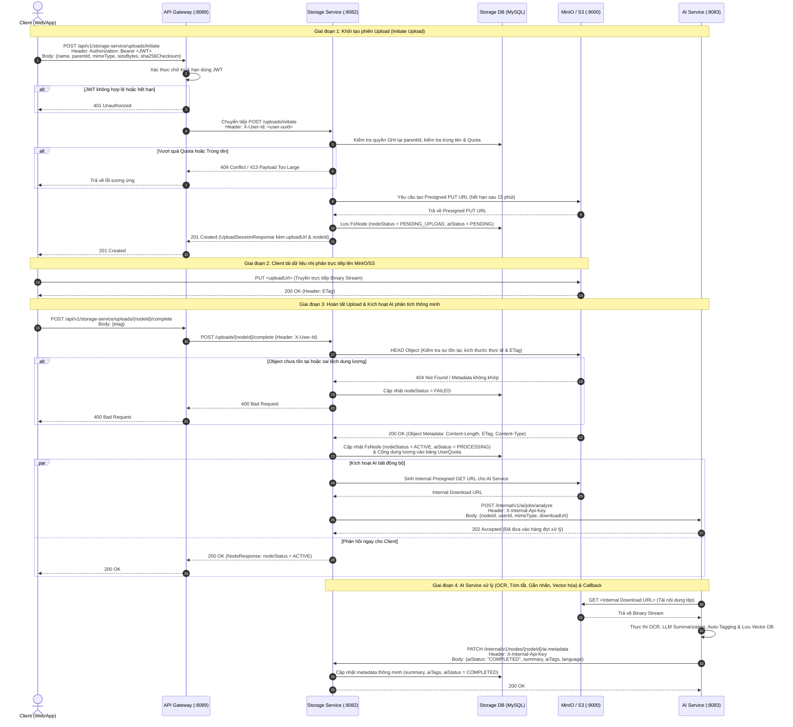
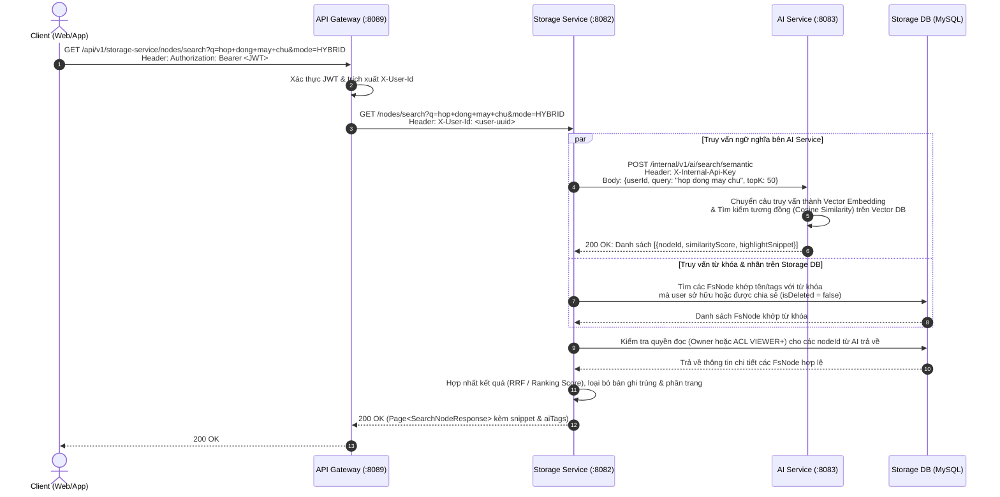
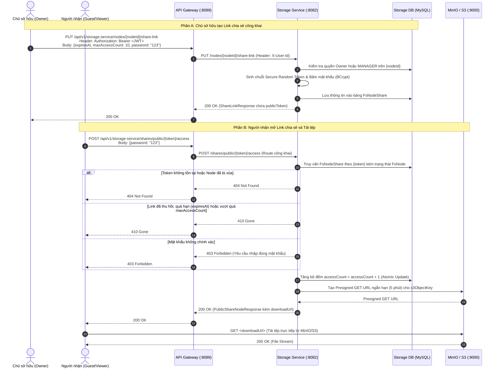
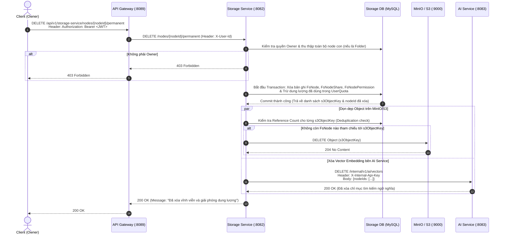

# Đặc tả Thiết kế API: Storage Service (Hệ thống Cloud Thông Minh)

Tài liệu này định nghĩa kiến trúc, quy ước bảo mật, thiết kế chi tiết RESTful API cho `storage-service` và luồng giao tiếp liên dịch vụ (Inter-service Communication) trong đề tài **Cloud Thông Minh (Smart Cloud)**.

---

## 1. Tổng quan Kiến trúc & Phạm vi Hệ thống

Trong hệ thống **Cloud Thông Minh**, `storage-service` không chỉ quản lý cây thư mục/tập tin (Metadata Tree) và giao tiếp với Object Storage (MinIO/S3), mà còn đóng vai trò là nguồn cung cấp dữ liệu cho **`agent-service` (Smart Processing Service)**

### 1.1. Thông tin định tuyến & Mạng nội bộ

- **Public Base URL:** `http://localhost:8089/api/v1/storage-service`
- **Internal Base URL (`storage-service`):** `http://localhost:8082`
- **Internal Base URL (`ai-service`):** `http://localhost:8083` (Service xử lý tác vụ AI/Smart Cloud)
- **Object Storage (MinIO/S3 API):** `http://localhost:9000`
- **Content-Type:** `application/json`. Nếu không đề cập gì thêm mặc định sẽ là dạng này

### 1.2. Cơ chế Xác thực & Bảo mật Liên dịch vụ

1. **Luồng từ người dùng (Client -> API Gateway -> Storage Service):**
   - Client gửi `Authorization: Bearer <access-token>`.
   - **API Gateway** xác thực JWT, loại bỏ header `Authorization` gốc và đính kèm:
     - `X-User-Id`: UUID của người dùng đã xác thực.
     - `X-User-Roles`: Danh sách quyền hệ thống.
   - **Ngoại lệ Public API:** Đường dẫn `/api/v1/storage-service/shares/public/**` được cấu hình mở (permitAll) trên Gateway; nếu người dùng đã đăng nhập vẫn có thể truyền `X-User-Id` tùy chọn.
2. **Luồng nội bộ (Storage Service <-> AI Service):**
   - Các API nội bộ đặt dưới tiền tố `/internal/v1/**` chỉ cho phép gọi trong mạng nội bộ (Docker network / VPC) kèm header xác thực dịch vụ `X-Internal-Api-Key` (hoặc mTLS/Service Token) và **chặn hoàn toàn trên API Gateway**.

### 1.3. Cấu trúc Response chuẩn (`ApiResponse`)

Mọi phản hồi JSON từ `storage-service` đều bọc trong cấu trúc chung:

```json
{
  "success": true,
  "message": "Thao tác thành công",
  "code": 200,
  "data": {},
  "timestamp": "2026-10-20T10:00:00Z"
}
```

---

## 2. Chuẩn hóa Metadata, Trạng thái & Khắc phục Thiết kế Cơ sở dữ liệu

Để khắc phục các điểm nghẽn trong thiết kế ban đầu và mở rộng cho Cloud Thông Minh, cơ sở dữ liệu và Entity `FsNode` được chuẩn hóa như sau:

1. **Khắc phục Unique Constraint tên Node:**
   - Thiết kế cũ đặt Unique trên `(parent_id, name)` sẽ gây lỗi khi 2 user khác nhau tạo folder cùng tên ở thư mục gốc (`parent_id = NULL`), đồng thời trong SQL chuẩn `NULL != NULL` khiến một user có thể tạo nhiều folder trùng tên ở root.
   - **Giải pháp:** Chuẩn hóa constraint thành `UNIQUE (user_id, parent_id, name, is_deleted)` kết hợp cột sinh tự động `parent_id_norm = COALESCE(parent_id, '00000000-0000-0000-0000-000000000000')`.
2. **Chuẩn hóa Enum Trạng thái (`nodeStatus`):**
   - `PENDING_UPLOAD`: Đã khởi tạo phiên upload nhưng chưa xác nhận hoàn tất trên S3/MinIO.
   - `ACTIVE`: Node hợp lệ và sẵn sàng sử dụng (Folder khi tạo mới mặc định là `ACTIVE`).
   - `QUARANTINED`: Tệp bị khóa tạm thời do phát hiện mã độc hoặc vi phạm chính sách.
   - `TEMP`: File tạm thời, có thể là để làm gì đó
   - `FAILED`: Quá trình upload thất bại hoặc quá hạn (chờ Cronjob dọn dẹp).
3. **Chuẩn hóa Enum Trạng thái Xử lý Thông minh (`aiStatus` - Mới):**
   - `NOT_APPLICABLE`: Áp dụng cho Folder hoặc định dạng tệp không hỗ trợ AI.
   - `PENDING`: Đang chờ `ai-service` xử lý.
   - `PROCESSING`: `ai-service` đang trích xuất dữ liệu (OCR/Embedding/Tagging).
   - `COMPLETED`: Đã trích xuất xong metadata thông minh (tags, summary, vectorId).
   - `FAILED`: Xử lý AI thất bại (vẫn cho phép người dùng tải/xem tệp bình thường).
4. **Chuẩn hóa Mã Quyền (`FsNodePermission.code`):**
   - `VIEWER`: Chỉ xem metadata, preview và tải xuống.
   - `EDITOR`: Được phép đổi tên, cập nhật nội dung, thêm/sửa node con (nếu là folder).
   - `MANAGER`: Toàn quyền như `EDITOR` và được phép quản lý chia sẻ (cấp quyền cho người khác).
   - _Lưu ý:_ Chủ sở hữu (`owner`) luôn có toàn quyền cao nhất, bao gồm xóa vĩnh viễn.

---

## 3. Thiết kế Chi tiết API

### 3.1. Nhóm API Duyệt cây thư mục & Smart Views

| Method  | Path                          | Request (Query / Body)                                              | Response (`data`)              | Mô tả chi tiết                                                                                          |
| :------ | :---------------------------- | :------------------------------------------------------------------ | :----------------------------- | :------------------------------------------------------------------------------------------------------ |
| `GET`   | `/nodes`                      | Query: `parentId`, `kind` (`FILE`/`FOLDER`), `page`, `size`, `sort` | `Page<NodeResponse>`           | Liệt kê các node con trực tiếp. Bỏ trống `parentId` để lấy thư mục gốc (Root).                          |
| `POST`  | `/nodes/folders`              | Body: `CreateFolderRequest`                                         | `201` — `NodeResponse`         | Tạo thư mục mới ở trạng thái `ACTIVE`.                                                                  |
| `GET`   | `/nodes/{nodeId}`             | Path: `nodeId`                                                      | `200` — `NodeDetailResponse`   | Xem chi tiết metadata của node (kèm quyền hiện tại và metadata AI).                                     |
| `GET`   | `/nodes/{nodeId}/breadcrumbs` | Path: `nodeId`                                                      | `200` — `List<BreadcrumbItem>` | Lấy đường dẫn từ Root tới node hiện tại để hiển thị thanh điều hướng.                                   |
| `PATCH` | `/nodes/{nodeId}`             | Body: `UpdateNodeRequest`                                           | `200` — `NodeResponse`         | Đổi tên, di chuyển sang thư mục khác (`parentId`), gắn/bỏ dấu sao (`isStarred`), cập nhật `customTags`. |
| `POST`  | `/nodes/{nodeId}/copy`        | Body: `CopyNodeRequest`                                             | `201` — `NodeResponse`         | Nhân bản file/folder sang thư mục đích (hỗ trợ Copy-on-Write hoặc S3 CopyObject).                       |
| `GET`   | `/nodes/starred`              | Query: `page`, `size`, `sort`                                       | `200` — `Page<NodeResponse>`   | Danh sách các file/folder được đánh dấu quan trọng (`isStarred = true`).                                |
| `GET`   | `/nodes/recent`               | Query: `limit` (mặc định `20`)                                      | `200` — `List<NodeResponse>`   | Danh sách các tệp vừa truy cập hoặc chỉnh sửa gần đây.                                                  |

#### Mẫu Payload:

- **`CreateFolderRequest`:**

```json
{
  "name": "Tai-lieu-du-an-2026",
  "parentId": "24f47bb8-b1b7-4e41-a704-dc67cd4e23e0"
}
```

- **`UpdateNodeRequest`:**

```json
{
  "name": "Bao-cao-tai-chinh-Q3",
  "parentId": "24f47bb8-b1b7-4e41-a704-dc67cd4e23e0",
  "isStarred": true,
  "customTags": ["tai-chinh", "quan-trong"]
}
```

---

### 3.2. Nhóm API Thùng rác (Trash), Khôi phục & Quản lý Dung lượng (Quota)

| Method   | Path                        | Request                       | Response (`data`)            | Mô tả chi tiết                                                                                                                                           |
| :------- | :-------------------------- | :---------------------------- | :--------------------------- | :------------------------------------------------------------------------------------------------------------------------------------------------------- |
| `DELETE` | `/nodes/{nodeId}`           | Path: `nodeId`                | `200` — `MessageResponse`    | **Xóa mềm (Soft Delete):** Đánh dấu `isDeleted = true` đệ quy toàn bộ cây con.                                                                           |
| `GET`    | `/nodes/trash`              | Query: `page`, `size`, `sort` | `200` — `Page<NodeResponse>` | Liệt kê các node gốc đang nằm trong thùng rác của user.                                                                                                  |
| `POST`   | `/nodes/{nodeId}/restore`   | Path: `nodeId`                | `200` — `NodeResponse`       | Khôi phục node từ thùng rác. Nếu thư mục cha đã bị xóa, tự động khôi phục về Root hoặc báo lỗi `409` tùy cờ `restoreToRoot`.                             |
| `DELETE` | `/nodes/{nodeId}/permanent` | Path: `nodeId`                | `200` — `MessageResponse`    | **Xóa vĩnh viễn:** Xóa bản ghi DB, giải phóng Quota, xóa object trên MinIO (nếu không còn tệp nào tham chiếu cùng hash) và xóa chỉ mục bên `ai-service`. |
| `DELETE` | `/nodes/trash/empty`        | Không có                      | `202` — `MessageResponse`    | Dọn sạch toàn bộ thùng rác của user (xử lý bất đồng bộ).                                                                                                 |
| `GET`    | `/quota`                    | Không có                      | `200` — `QuotaResponse`      | Lấy thông tin dung lượng đã dùng, tổng dung lượng giới hạn và phân bổ theo loại tệp.                                                                     |

#### Mẫu Payload `QuotaResponse`:

```json
{
  "usedBytes": 5368709120,
  "LimitBytes": 16106127360,
  "usagePercentage": 33.33,
  "breakdownByType": {
    "DOCUMENT": 1073741824,
    "IMAGE": 2147483648,
    "VIDEO": 2147483648,
    "OTHER": 0
  }
}
```

---

### 3.3. Nhóm API Upload (Hỗ trợ Smart Deduplication) & Download

Để tối ưu băng thông cho Cloud Thông Minh, bước khởi tạo Upload nhận thêm mã băm `sha256Checksum` (tùy chọn). Nếu tệp có cùng mã băm đã tồn tại trên hệ thống và hợp lệ, service có thể kích hoạt **Instant Upload (Deduplication)** hoặc cấp Presigned URL như thông thường.

| Method | Path                           | Request                                      | Response (`data`)               | Mô tả chi tiết                                                                                                                         |
| :----- | :----------------------------- | :------------------------------------------- | :------------------------------ | :------------------------------------------------------------------------------------------------------------------------------------- |
| `POST` | `/uploads/initiate`            | Body: `InitiateUploadRequest`                | `201` — `UploadSessionResponse` | Kiểm tra Quota, tạo node `PENDING_UPLOAD` và trả về Presigned URL (hoặc báo `instantUploaded: true` nếu trùng hash).                   |
| `POST` | `/uploads/{nodeId}/complete`   | Body: `CompleteUploadRequest`                | `200` — `NodeResponse`          | Gọi `HEAD Object` lên MinIO để xác thực dung lượng/ETag, chuyển trạng thái sang `ACTIVE`, cộng Quota và bắn sự kiện sang `ai-service`. |
| `GET`  | `/nodes/{nodeId}/download-url` | Query: `disposition` (`attachment`/`inline`) | `200` — `DownloadUrlResponse`   | Kiểm tra quyền `VIEWER` trở lên và cấp Presigned GET URL có thời hạn ngắn (ví dụ 15 phút).                                             |

#### Mẫu Payload:

- **`InitiateUploadRequest`:**

```json
{
  "name": "hop-dong-kinh-te.pdf",
  "parentId": "24f47bb8-b1b7-4e41-a704-dc67cd4e23e0",
  "mimeType": "application/pdf",
  "sizeBytes": 2097152,
  "sha256Checksum": "e3b0c44298fc1c149afbf4c8996fb92427ae41e4649b934ca495991b7852b855"
}
```

- **`UploadSessionResponse`:**

```json
{
  "node": {
    "id": "d098aed5-c455-4bfa-881e-33bc128282ec",
    "name": "hop-dong-kinh-te.pdf",
    "isFolder": false,
    "nodeStatus": "PENDING_UPLOAD"
  },
  "instantUploaded": false,
  "uploadUrl": "http://localhost:9000/smart-cloud-bucket/...",
  "method": "PUT",
  "expiresAt": "2026-10-20T10:15:00Z",
  "requiredHeaders": {
    "Content-Type": "application/pdf"
  }
}
```

---

### 3.4. Nhóm API Chia sẻ & Phân quyền (Sharing & ACL)

| Method   | Path                                         | Request                          | Response (`data`)                  | Mô tả chi tiết                                                                                                                         |
| :------- | :------------------------------------------- | :------------------------------- | :--------------------------------- | :------------------------------------------------------------------------------------------------------------------------------------- |
| `GET`    | `/nodes/shared-with-me`                      | Query: `page`, `size`, `sort`    | `200` — `Page<NodeResponse>`       | Liệt kê danh sách các file/folder được người khác chia sẻ trực tiếp với user hiện tại.                                                 |
| `GET`    | `/nodes/{nodeId}/shares`                     | Path: `nodeId`                   | `200` — `NodeShareSummaryResponse` | Lấy danh sách link công khai và danh sách user đang được cấp quyền trên node.                                                          |
| `PUT`    | `/nodes/{nodeId}/share-link`                 | Body: `UpsertShareLinkRequest`   | `200` — `ShareLinkResponse`        | Tạo mới hoặc cập nhật cấu hình link chia sẻ công khai (hạn dùng, số lượt tải tối đa, mật khẩu bảo vệ).                                 |
| `DELETE` | `/nodes/{nodeId}/share-link`                 | Path: `nodeId`                   | `200` — `MessageResponse`          | Thu hồi link chia sẻ công khai.                                                                                                        |
| `POST`   | `/shares/public/{token}/access`              | Body: `AccessPublicShareRequest` | `200` — `PublicShareNodeResponse`  | Truy cập link công khai (dùng `POST` để truyền `password` an toàn trong body nếu link đặt mật khẩu); trả về metadata và `downloadUrl`. |
| `PUT`    | `/nodes/{nodeId}/permissions/{targetUserId}` | Body: `GrantPermissionRequest`   | `200` — `NodePermissionResponse`   | Cấp hoặc cập nhật quyền (`VIEWER`, `EDITOR`, `MANAGER`) cho một user cụ thể.                                                           |
| `DELETE` | `/nodes/{nodeId}/permissions/{targetUserId}` | Path: `nodeId`, `targetUserId`   | `200` — `MessageResponse`          | Thu hồi quyền truy cập của `targetUserId` trên node.                                                                                   |

#### Mẫu Payload `UpsertShareLinkRequest`:

```json
{
  "expiresAt": "2026-10-30T23:59:59Z",
  "maxAccessCount": 50,
  "password": " OptionalSecret123!"
}
```

---

### 3.5. Nhóm API Cloud Thông Minh (Smart Cloud & AI Integration)

Đây là nhóm API tạo nên giá trị cốt lõi của đề tài **Cloud Thông Minh**, bao gồm API cho người dùng cuối và API nội bộ để giao tiếp với `ai-service`.

#### A. API phục vụ Người dùng (Public qua API Gateway)

| Method | Path                             | Request                                                                                                        | Response (`data`)                      | Mô tả chi tiết                                                                                                                                                                    |
| :----- | :------------------------------- | :------------------------------------------------------------------------------------------------------------- | :------------------------------------- | :-------------------------------------------------------------------------------------------------------------------------------------------------------------------------------- |
| `GET`  | `/nodes/search`                  | Query: `q`, `mode` (`KEYWORD`, `SEMANTIC`, `HYBRID`), `tags`, `mimeType`, `fromDate`, `toDate`, `page`, `size` | `200` — `Page<SearchNodeResponse>`     | **Tìm kiếm thông minh:** Kết hợp tìm theo tên/tag tại `storage-service` và gọi sang `ai-service` để tìm kiếm ngữ nghĩa (Vector Search) theo nội dung bên trong tài liệu/hình ảnh. |
| `GET`  | `/nodes/{nodeId}/smart-metadata` | Path: `nodeId`                                                                                                 | `200` — `SmartMetadataResponse`        | Lấy kết quả phân tích AI của tệp: bản tóm tắt (`summary`), văn bản OCR (`extractedTextPreview`), nhãn tự động (`aiTags`), thực thể nhận diện được (`entities`).                   |
| `POST` | `/nodes/{nodeId}/ai-reanalyze`   | Body: `ReanalyzeRequest`                                                                                       | `202` — `MessageResponse`              | Yêu cầu `ai-service` phân tích lại tệp (ví dụ: tóm tắt lại hoặc chạy lại OCR).                                                                                                    |
| `GET`  | `/nodes/duplicates`              | Query: `page`, `size`                                                                                          | `200` — `Page<DuplicateGroupResponse>` | Liệt kê các nhóm tệp bị trùng lặp nội dung (cùng `sha256Checksum` hoặc trùng lặp ngữ nghĩa cao) để gợi ý người dùng dọn dẹp giải phóng dung lượng.                                |

#### Mẫu Payload `SmartMetadataResponse`:

```json
{
  "nodeId": "d098aed5-c455-4bfa-881e-33bc128282ec",
  "aiStatus": "COMPLETED",
  "summary": "Hợp đồng cung cấp thiết bị máy chủ đám mây giữa Công ty A và Công ty B trị giá 1.5 tỷ VNĐ, thời hạn triển khai 6 tháng.",
  "aiTags": ["hop-dong", "may-chu", "tai-chinh", "2026"],
  "detectedLanguage": "vi",
  "processedAt": "2026-10-20T10:02:15Z"
}
```

#### B. API Nội bộ giữa `storage-service` và `ai-service` (Internal Service-to-Service)

| Chiều gọi                    | Method & Path                                   | Request                   | Response                             | Mô tả chi tiết                                                                                                                                                                 |
| :--------------------------- | :---------------------------------------------- | :------------------------ | :----------------------------------- | :----------------------------------------------------------------------------------------------------------------------------------------------------------------------------- |
| `Storage` $\rightarrow$ `AI` | `POST /internal/v1/ai/jobs/analyze`             | `AiAnalyzeJobRequest`     | `202 Accepted`                       | `storage-service` gọi sang `ai-service` (hoặc bắn qua Message Queue) ngay sau khi tệp chuyển sang `ACTIVE`, kèm Presigned GET URL nội bộ để `ai-service` tải tệp về phân tích. |
| `Storage` $\rightarrow$ `AI` | `POST /internal/v1/ai/search/semantic`          | `SemanticSearchRequest`   | `200` — Danh sách `nodeId` & `score` | `storage-service` ủy quyền truy vấn ngữ nghĩa sang Vector DB của `ai-service`, sau đó lọc lại theo quyền truy cập (`userId`/ACL) trước khi trả về cho Client.                  |
| `AI` $\rightarrow$ `Storage` | `PATCH /internal/v1/nodes/{nodeId}/ai-metadata` | `UpdateAiMetadataRequest` | `200 OK`                             | **Webhook/Callback:** `ai-service` gọi ngược lại `storage-service` sau khi chạy xong OCR/LLM để lưu `aiStatus`, `summary`, `aiTags`.                                           |

---

## 4. Sơ đồ Tuần tự (Mermaid Sequence Diagrams)

Dưới đây là 4 sơ đồ tuần tự mô tả đầy đủ các luồng giao tiếp cốt lõi giữa các service trong hệ thống.

### 4.1. Luồng 1: Upload Tệp tin, Xác thực Object & Kích hoạt Xử lý AI (Smart Upload Flow)

Sơ đồ này mô tả sự phối hợp giữa **Client**, **API Gateway**, **Storage Service**, **MinIO (S3)** và **AI Service** từ lúc bắt đầu tải tệp lên cho đến khi tệp được AI phân tích tự động.



---

### 4.2. Luồng 2: Tìm kiếm Thông minh Lai ghép (Hybrid Semantic Search giữa Storage Service và AI Service)

Sơ đồ này thể hiện cách hai service (`storage-service` và `ai-service`) phối hợp để thực hiện tìm kiếm theo ngữ nghĩa (Semantic Search) nhưng vẫn đảm bảo nghiêm ngặt quyền truy cập (ACL/Ownership) tại `storage-service`.



---

### 4.3. Luồng 3: Chia sẻ Công khai & Kiểm soát Truy cập (Public Share Link & Permission Flow)

Sơ đồ mô tả luồng chủ sở hữu tạo liên kết chia sẻ và luồng người nhận truy cập liên kết đó để tải tệp.



---

### 4.4. Luồng 4: Xóa Vĩnh Viễn & Đồng bộ Dọn dẹp Liên dịch vụ (Permanent Delete & Cleanup Flow)

Khi người dùng xóa vĩnh viễn một node từ thùng rác, `storage-service` phải đảm bảo tính nhất quán dữ liệu giữa Database, MinIO/S3 (chú ý cơ chế Deduplication) và Vector Index bên `ai-service`.



---

## 5. Tổng hợp Quy tắc Mã lỗi (Error Handling)

|       HTTP Status       | Mã lỗi nội bộ gợi ý                | Trường hợp áp dụng                                                                                              |
| :---------------------: | :--------------------------------- | :-------------------------------------------------------------------------------------------------------------- |
|    `400 Bad Request`    | `INVALID_REQUEST`                  | Dữ liệu đầu vào không hợp lệ, di chuyển thư mục vào chính con cháu của nó, hoặc gọi `complete` khi chưa upload. |
|   `401 Unauthorized`    | `UNAUTHORIZED`                     | Thiếu JWT hoặc JWT hết hạn (xử lý tại API Gateway) hoặc thiếu `X-Internal-Api-Key` ở luồng internal.            |
|     `403 Forbidden`     | `ACCESS_DENIED`                    | Người dùng không sở hữu node, không đủ quyền (`VIEWER` cố tình sửa/xóa), hoặc nhập sai mật khẩu link chia sẻ.   |
|     `404 Not Found`     | `RESOURCE_NOT_FOUND`               | Không tìm thấy `nodeId`, `parentId`, hoặc `token` chia sẻ không tồn tại.                                        |
|     `409 Conflict`      | `NAME_CONFLICT` / `STATE_CONFLICT` | Trùng tên file/folder trong cùng một thư mục cha, hoặc khôi phục node khi thư mục cha vẫn nằm trong thùng rác.  |
|       `410 Gone`        | `SHARE_LINK_EXPIRED`               | Link chia sẻ công khai đã hết hạn thời gian, bị thu hồi hoặc vượt quá số lượt truy cập tối đa.                  |
| `413 Payload Too Large` | `QUOTA_EXCEEDED`                   | Kích thước tệp tải lên vượt quá giới hạn cho phép hoặc vượt quá dung lượng trống (Quota) của người dùng.        |
|    `502 Bad Gateway`    | `UPSTREAM_STORAGE_ERROR`           | Không thể kết nối tới MinIO/S3 hoặc `ai-service` gặp sự cố khi xử lý đồng bộ.                                   |
