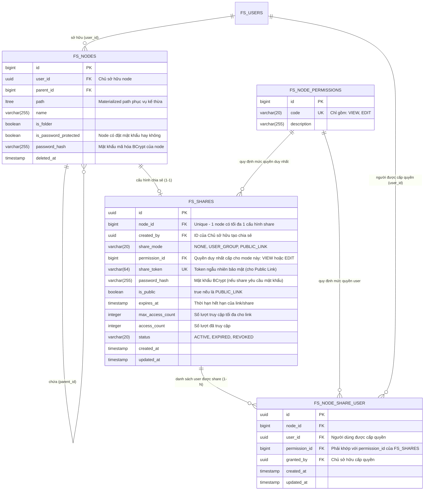
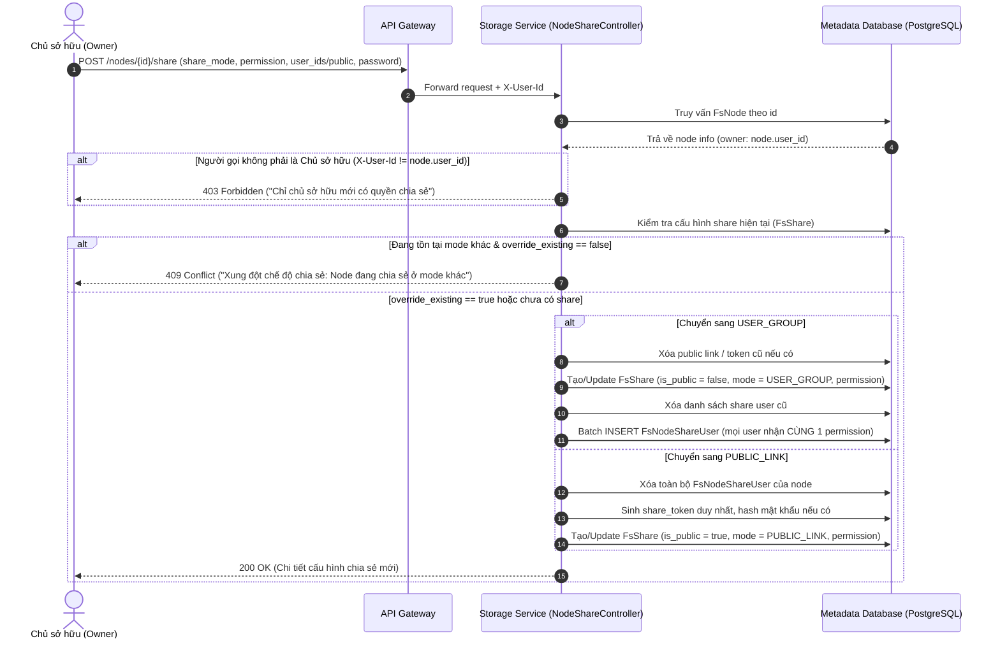
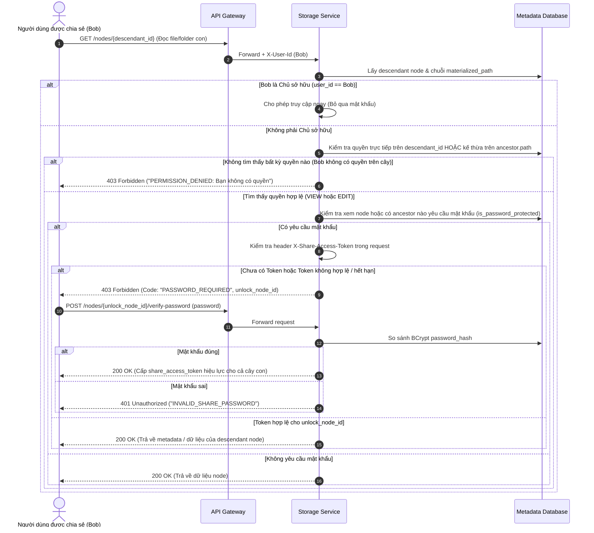

# Đặc tả Thiết kế API: Chia sẻ Tệp tin & Thư mục (Node Sharing)

Tài liệu này mô tả chi tiết toàn bộ thiết kế RESTful API cho tính năng **Chia sẻ Tệp tin (File) và Thư mục (Folder)** trong dịch vụ `storage-service`. Thiết kế đáp ứng đầy đủ các quy tắc nghiệp vụ về phân quyền, kế thừa quyền qua cây thư mục, cơ chế chia sẻ loại trừ lẫn nhau và bảo vệ an toàn bằng mật khẩu bởi chủ sở hữu.

---

## 1. Nguyên tắc Cốt lõi & Quy tắc Nghiệp vụ

### 1.1. Hệ thống Quyền Tối giản: Duy nhất 2 Quyền (`VIEW` và `EDIT`)

Hệ thống loại bỏ hoàn toàn các cấp độ quyền phức tạp hoặc trùng lặp, chỉ duy trì đúng 2 mức quyền thao tác:

| Quyền         | Mã quyền (`code`) | Phạm vi trên Tệp tin (File)                                                                                                                                       | Phạm vi trên Thư mục (Folder)                                                                                                                                                                               |
| ------------- | ----------------- | ----------------------------------------------------------------------------------------------------------------------------------------------------------------- | ----------------------------------------------------------------------------------------------------------------------------------------------------------------------------------------------------------- |
| **Xem**       | `VIEW`            | - Xem metadata của tệp (tên, kích thước, định dạng, ngày tạo).<br>- Xem nội dung tệp trực tuyến (Preview văn bản, ảnh, PDF).<br>- Tải tệp về máy tính (Download). | - Xem metadata của thư mục.<br>- Duyệt danh sách các tệp tin và thư mục con (`Browse`).<br>- Tải xuống các tệp tin con bên trong thư mục (kế thừa `VIEW`).                                                  |
| **Chỉnh sửa** | `EDIT`            | - Toàn bộ quyền của `VIEW`.<br>- Tải lên phiên bản nội dung mới ghi đè tệp tin.<br>- Đổi tên tệp tin.<br>- Cập nhật metadata của tệp.                             | - Toàn bộ quyền của `VIEW`.<br>- Tạo thư mục con mới bên trong.<br>- Tải lên (upload) tệp tin mới vào thư mục.<br>- Đổi tên các thư mục/tệp con.<br>- Di chuyển hoặc xóa mềm các tệp/thư mục con bên trong. |

> [!IMPORTANT]
> **Giới hạn của quyền `EDIT`:**
> Người được cấp quyền `EDIT` (dù là user được share hay người có link public) **KHÔNG ĐƯỢC PHÉP** thay đổi cấu hình chia sẻ, gán thêm quyền cho người khác, xóa vĩnh viễn node gốc được chia sẻ, hoặc thay đổi mật khẩu bảo vệ. Đây là các **đặc quyền bất khả xâm phạm của Chủ sở hữu (Owner)**.

---

### 1.2. Cơ chế Kế thừa Quyền (Permission Inheritance) & Báo lỗi Không có quyền

1. **Nguyên lý Kế thừa theo Cây Thư mục (Materialized Path):**
   - Cấu trúc cây thư mục trong `storage-service` được quản lý bằng đường dẫn phân cấp `materialized_path` (sử dụng kiểu dữ liệu PostgreSQL `ltree`, ví dụ: `root.1.5.12`).
   - **Quy tắc:** Nếu một người dùng được cấp quyền `P` (`VIEW` hoặc `EDIT`) trên Thư mục `A`, thì người dùng đó **mặc định sở hữu quyền `P` trên toàn bộ các tệp tin và thư mục con cháu (descendants) nằm dưới `A`**.
   - Biểu thức kiểm tra kế thừa trong SQL: `descendant.path <@ ancestor.path`.

2. **Thuật toán Phân giải Quyền (Permission Resolution Algorithm):**
   Khi một user thực hiện thao tác trên Node `N`:
   - **Bước 1 (Kiểm tra Chủ sở hữu):** Nếu `N.user_id == current_user_id`, cấp toàn quyền `OWNER`.
   - **Bước 2 (Kiểm tra Quyền Trực tiếp):** Kiểm tra xem có bản ghi chia sẻ trực tiếp cho `current_user_id` trên `N` hay không. Nếu có, nhận quyền đó.
   - **Bước 3 (Kiểm tra Kế thừa từ Tổ tiên):** Duyệt ngược các node tổ tiên của `N` theo thứ tự từ node cha gần nhất lên Root. Nếu tìm thấy một node tổ tiên được chia sẻ cho `current_user_id` với quyền `P`, node `N` tự động nhận quyền `P`.
   - **Bước 4 (Kiểm tra Public Link):** Nếu node `N` hoặc tổ tiên của nó được chia sẻ công khai và request có kèm phiên truy cập công khai hợp lệ, nhận quyền của Public Link (`VIEW` hoặc `EDIT`).
   - **Bước 5 (Từ chối & Báo lỗi):** Nếu không thỏa mãn bất kỳ điều kiện nào ở trên, hệ thống ngay lập tức chặn thao tác và trả về mã lỗi HTTP `403 Forbidden` (`PERMISSION_DENIED`). Mọi user khác không có quyền khi cố tình gọi API tới `node_id` này đều nhận lỗi `403`.

```
                  [Thư mục Dự án A] (Được share quyền VIEW cho Bob)
                          │
         ┌────────────────┴────────────────┐
         ▼                                 ▼
   [Tài liệu 1.pdf]               [Thư mục Con: Thiết kế]
(Kế thừa quyền VIEW)                (Kế thừa quyền VIEW)
                                           │
                                           ▼
                                    [Bản vẽ CAD.dwg]
                                  (Kế thừa quyền VIEW)
```

---

### 1.3. Nguyên tắc Độc quyền Chế độ Chia sẻ (Mutually Exclusive Sharing)

Tại bất kỳ thời điểm nào, một file hoặc folder chỉ có thể tồn tại ở **DUY NHẤT 1 trong 3 chế độ chia sẻ (`share_mode`)**:

```
                       ┌─────────────────────────┐
                       │   TRẠNG THÁI CHIA SẺ    │
                       └────────────┬────────────┘
                                    │
         ┌──────────────────────────┼──────────────────────────┐
         ▼                          ▼                          ▼
   ┌───────────┐             ┌─────────────┐            ┌─────────────┐
   │  PRIVATE  │             │ USER_GROUP  │            │ PUBLIC_LINK │
   │ (Mặc định)│             │ (Nhóm user) │            │ (Công khai) │
   └───────────┘             └─────────────┘            └─────────────┘
```

1. **Chế độ Riêng tư (`PRIVATE`):**
   - Chỉ duy nhất Chủ sở hữu (`Owner`) có quyền truy cập. Không ai khác có quyền.

2. **Chế độ Nhóm Người dùng (`USER_GROUP`):**
   - Cho phép lựa chọn nhiều user khác nhau (`user_ids`) để cấp quyền.
   - **Ràng buộc:** Cấp **CÙNG ĐÚNG 1 MỨC QUYỀN** (`VIEW` hoặc `EDIT`) cho toàn bộ nhóm user được chọn trong phiên chia sẻ đó.
   - Liên kết chia sẻ công khai bị **tắt hoàn toàn** (`is_public = false`, `share_token = null`). Bất kỳ ai không nằm trong danh sách nhóm user đều không thể truy cập.

3. **Chế độ Liên kết Công khai (`PUBLIC_LINK`):**
   - Cấp **ĐÚNG 1 MỨC QUYỀN** (`VIEW` hoặc `EDIT`) cho bất kỳ ai có liên kết (kèm mật khẩu nếu được yêu cầu).
   - Danh sách user riêng lẻ bị **xóa bỏ/vô hiệu hóa**. Không cho phép vừa có liên kết công khai vừa có phân quyền người dùng riêng rẽ trên cùng một node.

4. **Xử lý Xung đột Chế độ (Conflict Enforcement):**
   - Nếu node đang ở chế độ `USER_GROUP`, gọi API tạo Public Link sẽ bị từ chối với HTTP `409 Conflict` (Mã lỗi: `SHARE_MODE_CONFLICT`).
   - Nếu node đang ở chế độ `PUBLIC_LINK`, gọi API gán quyền cho danh sách user sẽ bị từ chối với HTTP `409 Conflict` (Mã lỗi: `SHARE_MODE_CONFLICT`).
   - Để chuyển đổi giữa 2 chế độ, Chủ sở hữu phải:
     - Hoặc truyền tham số `override_existing: true` trong API chia sẻ để hệ thống tự động xóa bỏ cấu hình của chế độ cũ và chuyển sang chế độ mới.
     - Hoặc gọi API `DELETE /nodes/{id}/share` để đưa về `PRIVATE` trước khi tạo chế độ mới.

---

### 1.4. Phân biệt Chủ sở hữu & Cơ chế Bảo vệ bằng Mật khẩu (Password Protection)

#### A. Phân biệt Chủ sở hữu (Owner)

- Chủ sở hữu được xác định bằng trường `fs_nodes.user_id` khớp với `X-User-Id` của token đăng nhập.
- **Đặc quyền của Chủ sở hữu:**
  - Toàn quyền đọc, ghi, đổi tên, di chuyển, xóa vĩnh viễn node.
  - Là người duy nhất có quyền thiết lập, thay đổi quyền, hoặc thu hồi chia sẻ (`POST/PUT/DELETE /nodes/{id}/share`).
  - Là người duy nhất có quyền đặt, thay đổi hoặc gỡ bỏ mật khẩu bảo vệ node (`PUT/DELETE /nodes/{id}/password`).
  - **Miễn trừ xác thực mật khẩu:** Khi Chủ sở hữu truy cập file/folder của chính mình, hệ thống nhận diện qua JWT danh tính và **không bao giờ yêu cầu Chủ sở hữu phải nhập mật khẩu**.

#### B. Cơ chế Bảo vệ bằng Mật khẩu (Password Protection)

- Chủ sở hữu có thể thiết lập mật khẩu truy cập trên node (áp dụng cho cả chế độ `USER_GROUP` hoặc `PUBLIC_LINK`).
- Mật khẩu được mã hóa an toàn bằng thuật toán **BCrypt** trước khi lưu vào trường `password_hash`.
- **Quy trình truy cập vào Node có mật khẩu:**
  1. Khi một người dùng được chia sẻ (hoặc khách vãng lai qua public link) gọi API truy cập node được bảo vệ (xem metadata, duyệt cây con, tải file, upload):
     - Hệ thống kiểm tra xem node hoặc có bất kỳ thư mục tổ tiên nào yêu cầu mật khẩu (`is_password_protected = true`) hay không.
     - Nếu có và trong request **chưa có header `X-Share-Access-Token`** (hoặc token không hợp lệ / hết hạn):
       Hệ thống trả về HTTP `403 Forbidden` kèm mã lỗi `PASSWORD_REQUIRED` và thông tin node cần mở khóa.
  2. Người dùng gọi API xác thực mật khẩu:
     - `POST /storage-service/nodes/{id}/verify-password` (đối với user đã đăng nhập).
     - `POST /storage-service/shares/public/{token}/access` (đối với khách truy cập public link).
  3. Hệ thống kiểm tra chuỗi mật khẩu với `password_hash`. Nếu chính xác:
     - Trả về một **`share_access_token`** (JWT ngắn hạn hoặc session token có thời hạn, ví dụ: 2 giờ hoặc 24 giờ).
  4. **Kế thừa trạng thái mở khóa mật khẩu:**
     - Nếu người dùng mở khóa thành công một Thư mục `F`, thì `share_access_token` này **có hiệu lực mở khóa cho Folder `F` và TOÀN BỘ các file/folder con cháu nằm bên dưới `F`**. Người dùng không cần phải nhập mật khẩu lặp lại cho từng file con!

---

## 2. Mô hình Cơ sở dữ liệu & Cấu trúc Dữ liệu



---

## 3. Danh mục API Tổng quan

| Phân nhóm                    | Method   | Đường dẫn Endpoint                                              | Phân quyền (Actor) | Mô tả tóm tắt                                                                        |
| ---------------------------- | -------- | --------------------------------------------------------------- | ------------------ | ------------------------------------------------------------------------------------ |
| **Quản lý Chia sẻ (Owner)**  | `POST`   | `/storage-service/nodes/{id}/share`                             | Chỉ Chủ sở hữu     | Thiết lập chia sẻ (`USER_GROUP` hoặc `PUBLIC_LINK`) với đúng 1 quyền (`VIEW`/`EDIT`) |
|                              | `GET`    | `/storage-service/nodes/{id}/share`                             | Chỉ Chủ sở hữu     | Xem chi tiết cấu hình chia sẻ hiện tại của file/folder                               |
|                              | `PUT`    | `/storage-service/nodes/{id}/share/users`                       | Chỉ Chủ sở hữu     | Thêm/xóa user hoặc đổi mức quyền nhóm user (chỉ trong mode `USER_GROUP`)             |
|                              | `DELETE` | `/storage-service/nodes/{id}/share/users/{userId}`              | Chỉ Chủ sở hữu     | Thu hồi quyền truy cập của một user cụ thể trong nhóm                                |
|                              | `DELETE` | `/storage-service/nodes/{id}/share`                             | Chỉ Chủ sở hữu     | Hủy toàn bộ chia sẻ, đưa node về chế độ riêng tư (`PRIVATE`)                         |
| **Bảo vệ Mật khẩu (Owner)**  | `PUT`    | `/storage-service/nodes/{id}/password`                          | Chỉ Chủ sở hữu     | Đặt mới hoặc thay đổi mật khẩu bảo vệ cho file/folder                                |
|                              | `DELETE` | `/storage-service/nodes/{id}/password`                          | Chỉ Chủ sở hữu     | Gỡ bỏ mật khẩu bảo vệ của file/folder                                                |
| **Xác thực Mật khẩu**        | `POST`   | `/storage-service/nodes/{id}/verify-password`                   | User được chia sẻ  | Nhập mật khẩu để mở khóa node và nhận `share_access_token`                           |
| **Dành cho User được Share** | `GET`    | `/storage-service/nodes/shared-with-me`                         | User đã đăng nhập  | Liệt kê danh sách file/folder được người khác chia sẻ với tôi                        |
|                              | `GET`    | `/storage-service/nodes/{id}/access`                            | User đã đăng nhập  | Kiểm tra quyền hiệu dụng thực tế của tôi trên một node cụ thể                        |
| **Truy cập Public Link**     | `GET`    | `/storage-service/shares/public/{shareToken}`                   | Công khai (Public) | Xem metadata công khai của node và kiểm tra có mật khẩu hay không                    |
|                              | `POST`   | `/storage-service/shares/public/{shareToken}/access`            | Công khai (Public) | Nhập mật khẩu mở khóa link công khai và nhận phiên làm việc                          |
|                              | `GET`    | `/storage-service/shares/public/{shareToken}/nodes`             | Công khai (Public) | Duyệt file/folder con trong folder công khai (kế thừa quyền)                         |
|                              | `POST`   | `/storage-service/shares/public/{shareToken}/download`          | Công khai (Public) | Lấy Presigned URL tải file qua link công khai                                        |
|                              | `POST`   | `/storage-service/shares/public/{shareToken}/nodes/folders`     | Công khai (Public) | Tạo folder con trong folder công khai (Yêu cầu quyền `EDIT`)                         |
|                              | `POST`   | `/storage-service/shares/public/{shareToken}/files/upload-urls` | Công khai (Public) | Xin Presigned URL upload file vào folder công khai (Yêu cầu quyền `EDIT`)            |

---

## 4. Chi tiết Thiết kế RESTful API

### 4.1. Nhóm API Quản lý Chia sẻ (Owner Only)

#### 4.1.1. Thiết lập Chia sẻ Node (`POST /storage-service/nodes/{id}/share`)

Thiết lập chia sẻ file hoặc folder. Áp dụng quy tắc loại trừ lẫn nhau: chỉ được chọn **HOẶC nhóm người dùng (`USER_GROUP`) HOẶC công khai (`PUBLIC_LINK`)**, và **chỉ cấp đúng 1 quyền (`VIEW` hoặc `EDIT`)**.

- **Endpoint:** `POST /storage-service/nodes/{id}/share`
- **Controller:** `FsNodeShareController.createOrUpdateShare`
- **Headers bắt buộc:**
  - `Authorization: Bearer <access-token>`
  - `X-User-Id: <owner-uuid>`
- **Path Parameter:**
  - `id` (Long, Bắt buộc): ID của file hoặc folder cần chia sẻ.
- **Request Body (`ConfigureShareRequest`):**

```json
{
  "share_mode": "USER_GROUP",
  "permission": "VIEW",
  "user_ids": [
    "e4b2d184-2a67-4d92-8012-3f8d9c025112",
    "f5c3e295-3b78-4ea3-9123-4a9e0d136223"
  ],
  "password": "OptionalSecurePassword123!",
  "expires_at": "2026-12-31T23:59:59Z",
  "max_access_count": 100,
  "override_existing": false
}
```

| Trường dữ liệu      | Kiểu        |             Bắt buộc             | Ràng buộc validation                                                            | Mô tả                                                                |
| ------------------- | ----------- | :------------------------------: | ------------------------------------------------------------------------------- | -------------------------------------------------------------------- |
| `share_mode`        | string      |                Có                | Giá trị chỉ gồm: `"USER_GROUP"` hoặc `"PUBLIC_LINK"`                            | Chế độ chia sẻ muốn thiết lập                                        |
| `permission`        | string      |                Có                | Giá trị chỉ gồm: `"VIEW"` hoặc `"EDIT"`                                         | Quyền duy nhất cấp cho phiên chia sẻ này                             |
| `user_ids`          | array[UUID] | Có nếu `share_mode = USER_GROUP` | Tối thiểu 1 phần tử, các phần tử không trùng lặp, không chứa ID của chính Owner | Danh sách các user được cấp quyền đồng nhất                          |
| `password`          | string      |              Không               | Độ dài 6-100 ký tự (nếu có)                                                     | Mật khẩu bảo vệ yêu cầu người truy cập phải nhập                     |
| `expires_at`        | string ISO  |              Không               | Phải là thời điểm trong tương lai                                               | Thời hạn hết hạn của phiên chia sẻ                                   |
| `max_access_count`  | integer     |              Không               | Tối thiểu 1                                                                     | Số lượt truy cập tối đa (áp dụng cho `PUBLIC_LINK`)                  |
| `override_existing` | boolean     |              Không               | Mặc định `false`                                                                | Nếu `true`, tự động hủy mode chia sẻ cũ đang tồn tại nếu có xung đột |

- **Response `200 OK` / `201 Created` (`ApiResponse<NodeShareDetailResponse>`):**

```json
{
  "success": true,
  "message": "Thiết lập chia sẻ thành công",
  "code": 200,
  "data": {
    "node_id": 5,
    "node_name": "Tai-lieu-du-an-2026",
    "is_folder": true,
    "share_mode": "USER",
    "permission": "VIEW",
    "is_password_protected": true,
    "shared_url": null,
    "share_token": null,
    "expires_at": "2026-12-31T23:59:59Z",
    "universal_permission": "VIEW",
    "users": [
      {
        "user_id": "e4b2d184-2a67-4d92-8012-3f8d9c025112",
        "username": "bob_smith",
        "email": "bob@example.com",
        "created_at": "2026-10-31T10:15:00Z"
      },
      {
        "user_id": "f5c3e295-3b78-4ea3-9123-4a9e0d136223",
        "username": "bobby_dev",
        "email": "bobby.dev@company.com",
        "created_at": "2026-10-31T10:15:00Z"
      }
    ],
    "created_at": "2026-10-31T10:15:00Z",
    "updated_at": "2026-10-31T10:15:00Z"
  },
  "timestamp": "2026-10-31T10:15:00Z"
}
```

_Ví dụ Response khi thiết lập chế độ `PUBLIC_LINK`:_

```json
{
  "success": true,
  "message": "Thiết lập link chia sẻ công khai thành công",
  "code": 200,
  "data": {
    "node_id": 8,
    "node_name": "hop-dong-lao-dong.pdf",
    "is_folder": false,
    "share_mode": "PUBLIC_LINK",
    "permission": "VIEW",
    "is_password_protected": true,
    "shared_url": "https://cloud.myproject.vn/s/share?token=a8f9c1d2e3b4a5c6d7e8f9a0b1c2d3e4",
    "share_token": "a8f9c1d2e3b4a5c6d7e8f9a0b1c2d3e4",
    "expires_at": "2026-11-15T23:59:59Z",
    "max_access_count": 50,
    "access_count": 0,
    "users": [],
    "created_at": "2026-10-31T10:20:00Z",
    "updated_at": "2026-10-31T10:20:00Z"
  },
  "timestamp": "2026-10-31T10:20:00Z"
}
```

- **Mã lỗi thường gặp:**
  - `400 Bad Request`: Quyền không hợp lệ (không phải `VIEW` hoặc `EDIT`), `user_ids` trống khi chia sẻ nhóm, hoặc chứa ID của chính Owner.
  - `403 Forbidden`: Người gửi request không phải là Chủ sở hữu (`ONLY_OWNER_ALLOWED`).
  - `404 Not Found`: Không tìm thấy node hoặc một trong các `user_ids` không tồn tại.
  - `409 Conflict` (`SHARE_MODE_CONFLICT`): Node đang ở chế độ chia sẻ khác và `override_existing = false`.

---

#### 4.1.2. Lấy Cấu hình Chia sẻ Hiện tại (`GET /storage-service/nodes/{id}/share`)

Chỉ Chủ sở hữu mới có quyền xem toàn bộ chi tiết cấu hình chia sẻ của node (danh sách user, link token, trạng thái mật khẩu).

- **Endpoint:** `GET /storage-service/nodes/{id}/share`
- **Controller:** `FsNodeShareController.getShareDetail`
- **Headers:** `Authorization: Bearer <token>`, `X-User-Id: <owner-uuid>`
- **Response `200 OK` (`ApiResponse<NodeShareDetailResponse>`):** Cấu trúc tương tự Response mục 4.1.1. Nếu node chưa từng được chia sẻ, trường `share_mode` trả về `"PRIVATE"`, các mảng `users` rỗng và link là `null`.
- **Mã lỗi:**
  - `403 Forbidden`: Không phải Chủ sở hữu của node.
  - `404 Not Found`: Node không tồn tại.

---

#### 4.1.3. Cập nhật Nhóm Người dùng Chia sẻ (`PUT /storage-service/nodes/{id}/share/users`)

Chỉnh sửa danh sách user hoặc thay đổi mức quyền duy nhất của cả nhóm user. API này chỉ hoạt động khi node đang ở chế độ `USER_GROUP`.

- **Endpoint:** `PUT /storage-service/nodes/{id}/share/users`
- **Controller:** `FsNodeShareController.updateUserGroupShare`
- **Request Body (`UpdateUserGroupShareRequest`):**

```json
{
  "action": "ADD",
  "user_ids": ["d3a1c073-1956-4b81-9f01-2e7c8b914001"],
  "permission": "VIEW"
}
```

| Trường dữ liệu | Kiểu        |             Bắt buộc             | Ràng buộc                                                   | Mô tả                                                                                               |
| -------------- | ----------- | :------------------------------: | ----------------------------------------------------------- | --------------------------------------------------------------------------------------------------- |
| `action`       | string      |                Có                | `"ADD"`, `"REMOVE"`, `"CHANGE_PERMISSION"`, `"REPLACE_ALL"` | Hành động muốn thực hiện trên nhóm                                                                  |
| `user_ids`     | array[UUID] | Có (trừ khi `CHANGE_PERMISSION`) | Danh sách ID người dùng mục tiêu                            | User cần thêm, xóa hoặc thay thế                                                                    |
| `permission`   | string      |              Không               | Chỉ `"VIEW"` hoặc `"EDIT"`                                  | Quyền duy nhất áp dụng cho nhóm. Nếu truyền, toàn bộ user trong nhóm sẽ được đồng bộ sang quyền này |

- **Response `200 OK` (`ApiResponse<NodeShareDetailResponse>`):** Cập nhật thành công, trả về danh sách user và quyền mới nhất.
- **Mã lỗi:**
  - `400 Bad Request`: `action` không hợp lệ hoặc truyền user trùng lặp.
  - `409 Conflict`: Node hiện tại không ở chế độ `USER_GROUP`.

---

#### 4.1.4. Thu hồi Quyền của một User Cụ thể (`DELETE /storage-service/nodes/{id}/share/users/{userId}`)

Xóa bỏ quyền của một user cụ thể khỏi nhóm chia sẻ.

- **Endpoint:** `DELETE /storage-service/nodes/{id}/share/users/{userId}`
- **Controller:** `FsNodeShareController.revokeUserShare`
- **Path Parameters:**
  - `id` (Long, Bắt buộc): ID của node
  - `userId` (UUID, Bắt buộc): ID của user cần thu hồi quyền
- **Response `200 OK` (`ApiResponse<Void>`):**

```json
{
  "success": true,
  "message": "Đã thu hồi quyền truy cập của người dùng thành công",
  "code": 200,
  "timestamp": "2026-10-31T10:25:00Z"
}
```

---

#### 4.1.5. Hủy Toàn bộ Chia sẻ Node (`DELETE /storage-service/nodes/{id}/share`)

Đưa file hoặc folder về trạng thái riêng tư (`PRIVATE`). Thu hồi toàn bộ quyền của nhóm user hoặc vô hiệu hóa liên kết public.

- **Endpoint:** `DELETE /storage-service/nodes/{id}/share`
- **Controller:** `FsNodeShareController.revokeAllShare`
- **Response `200 OK` (`ApiResponse<Void>`):**

```json
{
  "success": true,
  "message": "Đã hủy bỏ toàn bộ chia sẻ. Node hiện ở chế độ riêng tư (PRIVATE)",
  "code": 200,
  "timestamp": "2026-10-31T10:30:00Z"
}
```

---

### 4.2. Nhóm API Quản lý Mật khẩu của Chủ sở hữu (Owner Password Protection)

Chủ sở hữu có thể thiết lập mật khẩu truy cập độc lập hoặc kết hợp cùng cấu hình chia sẻ.

#### 4.2.1. Đặt hoặc Đổi Mật khẩu Node (`PUT /storage-service/nodes/{id}/password`)

- **Endpoint:** `PUT /storage-service/nodes/{id}/password`
- **Controller:** `FsNodePasswordController.setOrChangePassword`
- **Headers:** `Authorization: Bearer <token>`, `X-User-Id: <owner-uuid>`
- **Request Body (`SetNodePasswordRequest`):**

```json
{
  "password": "MySuperSecretPassword@2026"
}
```

| Trường dữ liệu | Kiểu   | Bắt buộc | Ràng buộc validation      | Mô tả                            |
| -------------- | ------ | :------: | ------------------------- | -------------------------------- |
| `password`     | string |    Có    | Độ dài từ 6 đến 100 ký tự | Mật khẩu truy cập muốn thiết lập |

- **Response `200 OK` (`ApiResponse<NodePasswordStatusResponse>`):**

```json
{
  "success": true,
  "message": "Đã thiết lập mật khẩu bảo vệ cho file/thư mục thành công",
  "code": 200,
  "data": {
    "node_id": 5,
    "is_password_protected": true,
    "updated_at": "2026-10-31T10:35:00Z"
  },
  "timestamp": "2026-10-31T10:35:00Z"
}
```

---

#### 4.2.2. Gỡ bỏ Mật khẩu Node (`DELETE /storage-service/nodes/{id}/password`)

- **Endpoint:** `DELETE /storage-service/nodes/{id}/password`
- **Controller:** `FsNodePasswordController.removePassword`
- **Response `200 OK` (`ApiResponse<NodePasswordStatusResponse>`):**

```json
{
  "success": true,
  "message": "Đã gỡ bỏ mật khẩu bảo vệ thành công",
  "code": 200,
  "data": {
    "node_id": 5,
    "is_password_protected": false,
    "updated_at": "2026-10-31T10:40:00Z"
  },
  "timestamp": "2026-10-31T10:40:00Z"
}
```

---

### 4.3. Nhóm API Xác thực Mật khẩu Truy cập (Password Verification)

Dành cho người dùng được chia sẻ (trong nhóm `USER_GROUP`) khi truy cập vào node có bật mật khẩu. Sau khi xác thực đúng mật khẩu, hệ thống cấp phát một **`share_access_token`** dùng để đính kèm trong các request tiếp theo.

#### 4.3.1. Mở khóa Node bằng Mật khẩu (`POST /storage-service/nodes/{id}/verify-password`)

- **Endpoint:** `POST /storage-service/nodes/{id}/verify-password`
- **Controller:** `FsNodeAccessController.verifyNodePassword`
- **Headers:** `Authorization: Bearer <token>`, `X-User-Id: <user-uuid>`
- **Request Body (`VerifyPasswordRequest`):**

```json
{
  "password": "MySuperSecretPassword@2026"
}
```

- **Response `200 OK` (`ApiResponse<UnlockNodeResponse>`):**

```json
{
  "success": true,
  "message": "Xác thực mật khẩu thành công. Đã mở khóa quyền truy cập",
  "code": 200,
  "data": {
    "node_id": 5,
    "share_access_token": "eyJhbGciOiJIUzI1NiIsInR5cCI6IkpXVCJ9.eypub2RlX2lkIjo1LCJ1c2VyX2lkIjoiZTRiMmQxODQiLCJleHAiOjE3OTM0NTA0MDB9...",
    "token_type": "Bearer",
    "expires_in_seconds": 7200,
    "effective_permission": "VIEW",
    "applies_to_descendants": true
  },
  "timestamp": "2026-10-31T10:45:00Z"
}
```

> [!TIP]
> **Kế thừa mở khóa:** Giá trị `"applies_to_descendants": true` xác nhận rằng token này mở khóa cho chính thư mục `node_id: 5` và toàn bộ các file, thư mục con bên dưới nó. Client chỉ cần gửi kèm header `X-Share-Access-Token: <token>` cho mọi request thao tác trên cây con này.

- **Mã lỗi thường gặp:**
  - `401 Unauthorized` (`INVALID_SHARE_PASSWORD`): Mật khẩu không chính xác.
  - `403 Forbidden` (`PERMISSION_DENIED`): User không có quyền chia sẻ trên node này (dù biết mật khẩu cũng không được phép).
  - `404 Not Found`: Node không tồn tại.

---

### 4.4. Nhóm API Dành cho Người dùng được Chia sẻ (Shared Users)

#### 4.4.1. Danh sách File/Folder Được Chia Sẻ với Tôi (`GET /storage-service/nodes/shared-with-me`)

Liệt kê danh sách các file và thư mục gốc mà người khác đã trực tiếp chia sẻ cho tài khoản hiện tại.

- **Endpoint:** `GET /storage-service/nodes/shared-with-me`
- **Controller:** `SharedNodesController.getSharedWithMe`
- **Headers:** `Authorization: Bearer <token>`, `X-User-Id: <current-user-uuid>`
- **Query Parameters:**

| Tham số      | Kiểu    |     Mặc định     | Mô tả                                           |
| ------------ | ------- | :--------------: | ----------------------------------------------- |
| `node_type`  | string  |      `null`      | Lọc theo loại node: `"FILE"` hoặc `"FOLDER"`    |
| `permission` | string  |      `null`      | Lọc theo quyền được cấp: `"VIEW"` hoặc `"EDIT"` |
| `name`       | string  |      `null`      | Tìm kiếm theo tên file/folder                   |
| `page`       | integer |       `0`        | Trang hiện tại (bắt đầu từ 0)                   |
| `size`       | integer |       `20`       | Số lượng bản ghi mỗi trang                      |
| `sort`       | string  | `shared_at,desc` | Tiêu chí sắp xếp                                |

- **Response `200 OK` (`ApiResponse<PagedResponse<SharedWithMeNodeResponse>>`):**

```json
{
  "success": true,
  "message": "Lấy danh sách chia sẻ thành công",
  "code": 200,
  "data": {
    "content": [
      {
        "node_id": 5,
        "name": "Tai-lieu-du-an-2026",
        "is_folder": true,
        "mime_type": null,
        "size_bytes": 0,
        "permission": "VIEW",
        "is_password_protected": true,
        "is_unlocked": false,
        "owner": {
          "user_id": "7ac9e9d3-79a2-44ec-806d-7029af302116",
          "username": "alice",
          "email": "alice@example.com"
        },
        "shared_at": "2026-10-31T10:15:00Z"
      },
      {
        "node_id": 14,
        "name": "Thiet-ke-kien-truc.docx",
        "is_folder": false,
        "mime_type": "application/vnd.openxmlformats-officedocument.wordprocessingml.document",
        "size_bytes": 524288,
        "permission": "EDIT",
        "is_password_protected": false,
        "is_unlocked": true,
        "owner": {
          "user_id": "7ac9e9d3-79a2-44ec-806d-7029af302116",
          "username": "alice",
          "email": "alice@example.com"
        },
        "shared_at": "2026-10-31T09:00:00Z"
      }
    ],
    "page": 0,
    "size": 20,
    "total_elements": 2,
    "total_pages": 1,
    "last": true
  },
  "timestamp": "2026-10-31T10:50:00Z"
}
```

---

#### 4.4.2. Kiểm tra Quyền Hiệu dụng trên một Node (`GET /storage-service/nodes/{id}/access`)

Cho phép Client kiểm tra xem người dùng hiện tại có quyền gì trên một node (xem trực tiếp hoặc do kế thừa từ thư mục cha), và node có đang bị khóa bởi mật khẩu hay không.

- **Endpoint:** `GET /storage-service/nodes/{id}/access`
- **Controller:** `SharedNodesController.checkEffectiveAccess`
- **Headers:** `Authorization: Bearer <token>`, `X-User-Id: <current-user-uuid>` (tùy chọn: `X-Share-Access-Token: <token>`)
- **Response `200 OK` (`ApiResponse<EffectiveAccessResponse>`):**

```json
{
  "success": true,
  "code": 200,
  "data": {
    "node_id": 12,
    "node_name": "Ban-ve-CAD.dwg",
    "is_owner": false,
    "effective_permission": "VIEW",
    "is_inherited": true,
    "inherited_from_node_id": 5,
    "inherited_from_node_name": "Tai-lieu-du-an-2026",
    "is_password_protected": true,
    "is_unlocked": true,
    "can_view": true,
    "can_edit": false
  },
  "timestamp": "2026-10-31T10:55:00Z"
}
```

- **Mã lỗi khi không có quyền truy cập:**
  - `403 Forbidden` (`PERMISSION_DENIED`): Người dùng không có bất kỳ quyền nào trên node này hoặc các thư mục tổ tiên của nó.

---

### 4.5. Nhóm API Truy cập Liên kết Công khai (Public Link Access)

Các API này hỗ trợ người dùng không cần đăng nhập tài khoản (hoặc đã đăng nhập) truy cập vào file/folder thông qua `shareToken`.

#### 4.5.1. Xem Thông tin Liên kết Công khai (`GET /storage-service/shares/public/{shareToken}`)

- **Endpoint:** `GET /storage-service/shares/public/{shareToken}`
- **Yêu cầu xác thực:** Không (Public API)
- **Response `200 OK` (`ApiResponse<PublicShareInfoResponse>`):**

```json
{
  "success": true,
  "code": 200,
  "data": {
    "share_token": "a8f9c1d2e3b4a5c6d7e8f9a0b1c2d3e4",
    "node_name": "hop-dong-lao-dong.pdf",
    "is_folder": false,
    "mime_type": "application/pdf",
    "size_bytes": 1048576,
    "permission": "VIEW",
    "requires_password": true,
    "expires_at": "2026-11-15T23:59:59Z",
    "owner_display_name": "Alice"
  },
  "timestamp": "2026-10-31T11:00:00Z"
}
```

- **Mã lỗi thường gặp:**
  - `404 Not Found` (`SHARE_NOT_FOUND`): Token chia sẻ không tồn tại hoặc đã bị thu hồi.
  - `410 Gone` (`SHARE_EXPIRED`): Link chia sẻ đã hết hạn hoặc đã vượt quá số lượt truy cập tối đa (`max_access_count`).

---

#### 4.5.2. Mở khóa Truy cập Link Công khai (`POST /storage-service/shares/public/{shareToken}/access`)

Xác thực mật khẩu (nếu link có đặt mật khẩu) và tạo phiên làm việc công khai.

- **Endpoint:** `POST /storage-service/shares/public/{shareToken}/access`
- **Request Body (`PublicAccessRequest`):**

```json
{
  "password": "OptionalPasswordIfProtected"
}
```

- **Response `200 OK` (`ApiResponse<PublicAccessSessionResponse>`):**

```json
{
  "success": true,
  "message": "Truy cập link công khai thành công",
  "code": 200,
  "data": {
    "public_access_token": "pub_sess_7f8a9b0c1d2e3f4a5b6c7d8e9f0a1b2c",
    "token_type": "Bearer",
    "expires_in_seconds": 7200,
    "permission": "VIEW",
    "node": {
      "id": 8,
      "name": "hop-dong-lao-dong.pdf",
      "is_folder": false,
      "size_bytes": 1048576,
      "mime_type": "application/pdf"
    }
  },
  "timestamp": "2026-10-31T11:05:00Z"
}
```

---

#### 4.5.3. Duyệt Thư mục Con Công khai (`GET /storage-service/shares/public/{shareToken}/nodes`)

Cho phép duyệt các file và folder con bên trong một folder được chia sẻ công khai. Mọi node con đều **kế thừa quyền của link** (`VIEW` hoặc `EDIT`).

- **Endpoint:** `GET /storage-service/shares/public/{shareToken}/nodes`
- **Headers (nếu link yêu cầu mật khẩu):**
  - `X-Share-Access-Token: <public_access_token>`
- **Query Parameters:**

| Tham số     | Kiểu    | Mặc định | Mô tả                                                                                                                 |
| ----------- | ------- | :------: | --------------------------------------------------------------------------------------------------------------------- |
| `parent_id` | Long    |  `null`  | ID thư mục con cần duyệt (phải là hậu duệ hợp lệ của shared folder). Để `null` để lấy danh sách tại gốc shared folder |
| `page`      | integer |   `0`    | Số trang                                                                                                              |
| `size`      | integer |   `20`   | Kích thước trang                                                                                                      |

- **Response `200 OK` (`ApiResponse<PagedResponse<NodeResponse>>`):** Trả về danh sách file/folder con theo định dạng chuẩn.

---

#### 4.5.4. Tải Tệp tin Công khai (`POST /storage-service/shares/public/{shareToken}/download`)

Xin cấp Presigned URL để tải file trực tiếp từ MinIO/S3 qua link công khai.

- **Endpoint:** `POST /storage-service/shares/public/{shareToken}/download`
- **Headers:** `X-Share-Access-Token: <public_access_token>` (nếu có mật khẩu)
- **Request Body (`PublicDownloadRequest`):**

```json
{
  "node_id": 8
}
```

_(Lưu ý: Nếu link chia sẻ là một file duy nhất, `node_id` có thể bỏ qua. Nếu link chia sẻ là một folder, truyền `node_id` của file con nằm trong folder đó)._

- **Response `200 OK` (`ApiResponse<PresignedDownloadResponse>`):**

```json
{
  "success": true,
  "code": 200,
  "data": {
    "node_id": 8,
    "file_name": "hop-dong-lao-dong.pdf",
    "download_url": "http://localhost:9000/agentic-cloud/users/alice/hop-dong-lao-dong.pdf?X-Amz-Algorithm=...",
    "expires_in_seconds": 900
  },
  "timestamp": "2026-10-31T11:10:00Z"
}
```

---

#### 4.5.5. Thao tác Chỉnh sửa trong Folder Công khai (Chỉ khi Link có quyền `EDIT`)

Khi một thư mục được chia sẻ công khai với quyền `EDIT`, người có link (kèm phiên hợp lệ) được phép tải file mới lên hoặc tạo folder con bên trong:

1. **Tạo Folder con:** `POST /storage-service/shares/public/{shareToken}/nodes/folders`
   - Body: `{"name": "Thu-muc-moi", "parent_id": 5}`
   - Trả về `201 Created` nếu link có quyền `EDIT`. Trả về `403 Forbidden` (`PERMISSION_DENIED`) nếu link chỉ có quyền `VIEW`.
2. **Xin URL Upload Tệp mới:** `POST /storage-service/shares/public/{shareToken}/files/upload-urls`
   - Body: Danh sách file cần upload vào shared folder.
   - Trả về `200 OK` kèm Presigned PUT URL nếu link có quyền `EDIT`. Trả về `403 Forbidden` nếu link là `VIEW`.

---

## 5. Sơ đồ Luồng Nghiệp vụ & Sơ đồ Tuần tự (Mermaid Diagrams)

### 5.1. Sơ đồ Tuần tự: Thiết lập Chia sẻ & Kiểm tra Loại trừ lẫn nhau (Mutually Exclusive Enforcement)



---

### 5.2. Sơ đồ Tuần tự: Phân giải Quyền Kế thừa & Xác thực Mật khẩu khi Truy cập



---

## 6. Mô hình DTOs (Data Transfer Objects)

### 6.1. Request DTOs

#### `ConfigureShareRequest`

| Tên thuộc tính      | Kiểu dữ liệu  |       Bắt buộc        | Ràng buộc / Mô tả                             |
| ------------------- | ------------- | :-------------------: | --------------------------------------------- |
| `share_mode`        | String        |          Có           | `"USER_GROUP"` hoặc `"PUBLIC_LINK"`           |
| `permission`        | String        |          Có           | `"VIEW"` hoặc `"EDIT"`                        |
| `user_ids`          | List<UUID>    | Có (khi `USER_GROUP`) | Danh sách các user được cấp quyền đồng nhất   |
| `password`          | String        |         Không         | Mật khẩu bảo vệ (6-100 ký tự)                 |
| `expires_at`        | LocalDateTime |         Không         | Thời điểm hết hạn chia sẻ                     |
| `max_access_count`  | Integer       |         Không         | Số lượt truy cập tối đa cho link              |
| `override_existing` | Boolean       |         Không         | Mặc định `false`. Ghi đè nếu đang ở mode khác |

#### `UpdateUserGroupShareRequest`

| Tên thuộc tính | Kiểu dữ liệu | Bắt buộc | Ràng buộc / Mô tả                                           |
| -------------- | ------------ | :------: | ----------------------------------------------------------- |
| `action`       | String       |    Có    | `"ADD"`, `"REMOVE"`, `"CHANGE_PERMISSION"`, `"REPLACE_ALL"` |
| `user_ids`     | List<UUID>   |  Không   | Bắt buộc đối với các action `ADD`, `REMOVE`, `REPLACE_ALL`  |
| `permission`   | String       |  Không   | `"VIEW"` hoặc `"EDIT"`. Đổi quyền đồng bộ cho nhóm          |

#### `SetNodePasswordRequest`

| Tên thuộc tính | Kiểu dữ liệu | Bắt buộc | Ràng buộc / Mô tả                    |
| -------------- | ------------ | :------: | ------------------------------------ |
| `password`     | String       |    Có    | Mật khẩu truy cập từ 6 đến 100 ký tự |

#### `VerifyPasswordRequest`

| Tên thuộc tính | Kiểu dữ liệu | Bắt buộc | Ràng buộc / Mô tả     |
| -------------- | ------------ | :------: | --------------------- |
| `password`     | String       |    Có    | Mật khẩu cần xác thực |

---

### 6.2. Response DTOs

#### `NodeShareDetailResponse`

| Tên thuộc tính          | Kiểu dữ liệu                 | Mô tả                                                   |
| ----------------------- | ---------------------------- | ------------------------------------------------------- |
| `node_id`               | Long                         | ID của file hoặc folder                                 |
| `node_name`             | String                       | Tên file hoặc folder                                    |
| `is_folder`             | Boolean                      | `true` nếu là folder, `false` nếu là file               |
| `share_mode`            | String                       | `"PRIVATE"`, `"USER_GROUP"`, hoặc `"PUBLIC_LINK"`       |
| `permission`            | String                       | `"VIEW"` hoặc `"EDIT"` (hoặc `null` nếu `PRIVATE`)      |
| `is_password_protected` | Boolean                      | `true` nếu có mật khẩu bảo vệ                           |
| `shared_url`            | String                       | Đường dẫn đầy đủ của public link (nếu là `PUBLIC_LINK`) |
| `share_token`           | String                       | Token của public link                                   |
| `expires_at`            | LocalDateTime                | Thời hạn hiệu lực                                       |
| `max_access_count`      | Integer                      | Số lượt truy cập tối đa cho phép                        |
| `access_count`          | Integer                      | Số lượt đã truy cập thực tế                             |
| `users`                 | List<SharedUserItemResponse> | Danh sách các user đang được chia sẻ (khi `USER_GROUP`) |
| `created_at`            | LocalDateTime                | Thời gian tạo chia sẻ                                   |
| `updated_at`            | LocalDateTime                | Thời gian cập nhật gần nhất                             |

#### `SharedUserItemResponse`

| Tên thuộc tính | Kiểu dữ liệu  | Mô tả                               |
| -------------- | ------------- | ----------------------------------- |
| `user_id`      | UUID          | ID của người dùng được chia sẻ      |
| `username`     | String        | Username                            |
| `email`        | String        | Email                               |
| `permission`   | String        | Quyền được cấp (`VIEW` hoặc `EDIT`) |
| `created_at`   | LocalDateTime | Thời gian được thêm vào nhóm        |

#### `EffectiveAccessResponse`

| Tên thuộc tính             | Kiểu dữ liệu | Mô tả                                             |
| -------------------------- | ------------ | ------------------------------------------------- |
| `node_id`                  | Long         | ID node cần kiểm tra quyền                        |
| `node_name`                | String       | Tên node                                          |
| `is_owner`                 | Boolean      | `true` nếu người dùng hiện tại là Chủ sở hữu      |
| `effective_permission`     | String       | `"OWNER"`, `"VIEW"`, `"EDIT"`, hoặc `"NONE"`      |
| `is_inherited`             | Boolean      | `true` nếu quyền nhận được từ thư mục cha/tổ tiên |
| `inherited_from_node_id`   | Long         | ID của thư mục tổ tiên chia sẻ quyền gốc          |
| `inherited_from_node_name` | String       | Tên của thư mục tổ tiên chia sẻ quyền gốc         |
| `is_password_protected`    | Boolean      | `true` nếu node hoặc cây cha có mật khẩu          |
| `is_unlocked`              | Boolean      | `true` nếu đã mở khóa thành công trong phiên này  |
| `can_view`                 | Boolean      | `true` nếu có quyền xem/duyệt/tải                 |
| `can_edit`                 | Boolean      | `true` nếu có quyền sửa/tạo/upload                |

#### `UnlockNodeResponse`

| Tên thuộc tính           | Kiểu dữ liệu | Mô tả                                                           |
| ------------------------ | ------------ | --------------------------------------------------------------- |
| `node_id`                | Long         | ID node vừa mở khóa                                             |
| `share_access_token`     | String       | Token phiên làm việc để gửi trong header `X-Share-Access-Token` |
| `token_type`             | String       | Luôn có giá trị `"Bearer"`                                      |
| `expires_in_seconds`     | Long         | Thời gian hiệu lực của token (giây)                             |
| `effective_permission`   | String       | Mức quyền hiệu dụng (`VIEW` hoặc `EDIT`)                        |
| `applies_to_descendants` | Boolean      | Luôn là `true` (mở khóa cho cả cây con)                         |

---

## 7. Bảng Mã Lỗi Nghiệp vụ Chuẩn (Business Error Codes)

| Mã lỗi (`error`)          | HTTP Status | Thông báo mẫu                                                                                       | Nguyên nhân & Hướng giải quyết                                                                                       |
| ------------------------- | :---------: | --------------------------------------------------------------------------------------------------- | -------------------------------------------------------------------------------------------------------------------- |
| `ONLY_OWNER_ALLOWED`      |    `403`    | Chỉ chủ sở hữu mới có quyền thực hiện thao tác chia sẻ hoặc cấu hình mật khẩu trên tệp/thư mục này. | Người gửi request không phải là người tạo node (`node.user_id != caller.id`).                                        |
| `PERMISSION_DENIED`       |    `403`    | Bạn không có quyền truy cập tệp hoặc thư mục này.                                                   | Người dùng không phải Owner, không có quyền trực tiếp và không kế thừa quyền từ bất kỳ thư mục cha nào.              |
| `SHARE_MODE_CONFLICT`     |    `409`    | Node đang ở chế độ chia sẻ khác. Không thể chia sẻ công khai và chia sẻ nhóm người dùng cùng lúc.   | Cố gắng bật Public Link khi đang có danh sách User Share (hoặc ngược lại) mà không truyền `override_existing: true`. |
| `PASSWORD_REQUIRED`       |    `403`    | Tệp hoặc thư mục này được bảo vệ bằng mật khẩu. Vui lòng nhập mật khẩu để tiếp tục.                 | Chưa gửi `X-Share-Access-Token` hoặc token đã hết hạn khi truy cập node có mật khẩu.                                 |
| `INVALID_SHARE_PASSWORD`  |    `401`    | Mật khẩu truy cập không chính xác.                                                                  | Nhập sai mật khẩu khi gọi API xác thực mở khóa.                                                                      |
| `INVALID_PERMISSION_CODE` |    `400`    | Quyền không hợp lệ. Hệ thống chỉ hỗ trợ 2 quyền: VIEW và EDIT.                                      | Truyền quyền khác ngoài `VIEW` và `EDIT` (ví dụ: `MANAGE`, `DOWNLOAD`).                                              |
| `CANNOT_SHARE_WITH_SELF`  |    `400`    | Không thể chia sẻ tệp hoặc thư mục cho chính mình.                                                  | Danh sách `user_ids` chứa ID của chính Chủ sở hữu.                                                                   |
| `SHARE_NOT_FOUND`         |    `404`    | Liên kết chia sẻ không tồn tại hoặc đã bị thu hồi.                                                  | Sai `share_token` hoặc node đã bị đưa về chế độ riêng tư (`PRIVATE`).                                                |
| `SHARE_EXPIRED`           |    `410`    | Liên kết chia sẻ đã hết hạn sử dụng hoặc vượt quá số lượt truy cập cho phép.                        | Link đã quá thời điểm `expires_at` hoặc `access_count >= max_access_count`.                                          |
| `USER_NOT_FOUND`          |    `404`    | Một hoặc nhiều người dùng trong danh sách chia sẻ không tồn tại.                                    | `user_ids` chứa ID không tìm thấy trong `user-service`.                                                              |
